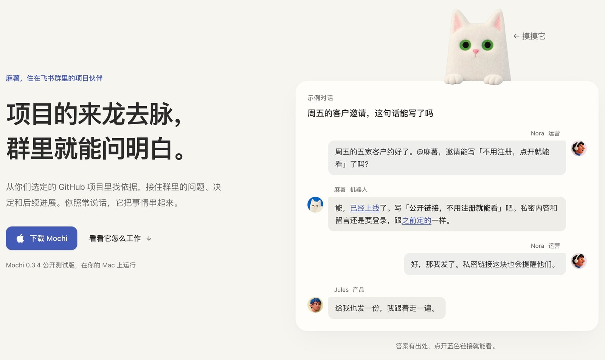

# Mochi

**Your team's project context, in the group chat.**

Mochi is a Mac companion for teams that discuss work in Feishu or Lark and
keep their project knowledge in GitHub. Ask what changed, why a decision was
made, or what's still blocked. Mochi looks in the projects you select and
brings the evidence back to the conversation.

[Download for Mac](https://mochi.host/download/?utm_source=github&utm_medium=readme&utm_campaign=public-launch) ·
[Explore the examples](https://mochi.host/?utm_source=github&utm_medium=readme&utm_campaign=public-launch#roles) ·
[中文](README.zh-CN.md)

[](https://mochi.host/?utm_source=github&utm_medium=readme&utm_campaign=public-launch#roles)

*An illustrative conversation from the website, not a customer transcript.
The current app interface and website are in Simplified Chinese.*

## Keep a piece of work moving

- **Get an answer you can check.** Ask about the code, Issues and PRs in the
  projects you selected. Follow the sources back to the original work.
- **Give a decision somewhere to live.** Ask Mochi to create or update an
  Issue, add an owner and keep a link to the discussion. Code and PRs remain
  read-only.
- **Pick up the same work later.** Ask what changed and what still needs
  attention, with the earlier discussion as context.

For example, before a customer invitation goes out:

> “Can we say people can open a shared link without signing in? Check the
> implementation and the related Issue; show me the sources.”

After the team decides what to do:

> “Update the existing Issue with this scope and assign it to Evan.”

Use a real teammate and an Issue from your selected project. These are example
requests, not a promise that any particular feature is ready.

## Try it with one project

1. [Download the public beta](https://mochi.host/download/?utm_source=github&utm_medium=readme&utm_campaign=public-launch)
   and drag Mochi into Applications. Initial setup needs Mac administrator
   authorization.
2. Connect your ChatGPT subscription or a compatible Responses API service,
   connect Feishu or Lark, and choose the GitHub projects Mochi may access.
3. Add your bot to a group, start it in Mochi, and @mention it with one real
   question about the project. Open the sources in its answer.

You'll need an **Apple silicon Mac running macOS 14 or later**, a Feishu or
Lark organization and a GitHub account with access to the project. Your
organization may require administrator approval. Setup happens in Mochi and
the services' authorization pages; no terminal is needed to use the app.

[Setup guide](https://mochi.host/start/) ·
[For organization admins](https://mochi.host/admin/) ·
[FAQ](https://mochi.host/faq/)

## Your accounts, your boundaries

- Mochi runs on your Mac with your own model account. Relevant context goes
  to the model service you choose; that service owns its usage and billing.
- GitHub access is limited to projects you explicitly select. Issue writes
  need an authorized request; Mochi does not edit code or merge PRs.
- Groups served by the **same bot share memory**. Separate bots keep their
  memory and project access separate. You can turn off a group's replies.
- Your Mac and the bot need to stay running and connected. This is not an
  always-on hosted service.

Read the [privacy information](https://mochi.host/privacy/) before connecting
work resources. The [download page](https://mochi.host/download/) owns the
current beta version, installation requirements and known limitations.

## Help shape Mochi

Try one real question, then tell us where the answer or setup fell short.
[Open an issue](https://github.com/aha-labs-hq/mochi/issues) with the version,
what you expected and what happened. Keep private conversations, credentials
and project content out of public reports. A star helps others find the project.

Code contributions are welcome; start with [CONTRIBUTING.md](CONTRIBUTING.md).
Report vulnerabilities privately as described in [SECURITY.md](SECURITY.md).

The source is under [Apache-2.0](LICENSE), with [NOTICE](NOTICE). The Mochi and
麻薯 names, characters and artwork have separate [trademark and artwork terms](TRADEMARKS.md).

## For developers

The desktop app uses Electrobun and React. The bridge embeds the Pi SDK and
connects through the official Lark CLI. Use the Bun version pinned in
`package.json`, then run `bun install --frozen-lockfile`.

[Product and onboarding](docs/onboarding.md) ·
[Architecture](docs/product-architecture.md) ·
[Development and verification](docs/github-governance.md#verification) ·
[Release preparation](docs/public-release.md)

Read [AGENTS.md](AGENTS.md) before changing the repository. The source branch
can include changes newer than the downloadable beta.

<details>
<summary>Engineering and operations reference (Chinese)</summary>

**Dependency override.** `package.json#overrides` pins Pi's transitive
`minimatch` to 11.0.1 for
[GHSA-g3hv-75wg-m249](https://github.com/advisories/GHSA-g3hv-75wg-m249).
Pi uses the retained `minimatch()` API for model/resource globs, not the
removed regular-expression APIs. `test/minimatchSecurity.test.ts` checks the
actual Pi-resolved dependency, bounded preprocessing and representative
matching behavior. Remove the override when Pi itself requires a fixed version;
keep the regression test. This source change does not update an installed App
or the existing public-beta download.

问件事，得先找对人；群里聊出了结果，还得有人接着做。麻薯把团队项目里的资料带到群里：查找有依据的答案，经授权把讨论整理成有负责人的 Issue，之后还能接着问进展。运营、设计、支持和开发都能共享这些上下文，减少反复找人和解释。

Mochi 是面向非技术用户的 ToC macOS companion，以及它所管理的飞书–Agent Bridge。当前每位用户连接自己的 ChatGPT 订阅或兼容 Responses API 的 API Key 模型服务、飞书组织/Bot/群和明确选定的 GitHub 项目。Mochi 负责技术配置，用户只负责登录、授权与选择。各群在同一个 Bot 内共享其永久 Pi Session 和记忆，它知道每件事出自哪个群，跨群转述有分寸；记忆不跨 Bot 或客户；群与话题仍决定激活、调度、回复位置和 Issue 授权边界。

一个部署可以创建多个 **Bot**。麻薯只是第一位：ChatGPT 订阅与多个命名的模型 API 连接属于应用共用设置；每位 Bot 独立拥有嘱咐、永久记忆、所选模型与思考深度、飞书连接、GitHub 登录/授权/项目选择、角色形象和启停状态。共用连接不共享记忆或项目授权。完整边界和显式离线接入旧账号的合同见 [独立 Bot 架构](docs/independent-bots.md)。

**角色方向：** 麻薯是第一个角色，专攻以 GitHub 为团队产品信息中心的场景；未来角色将服务创作等不同工作，不只是替换外观。上面的接入与运行合同描述当前麻薯，不定义所有未来角色。角色叙事、首次有用结果与产品/能力边界见 [`docs/onboarding.md`](docs/onboarding.md#characters-have-different-work-not-just-different-appearances)；形象通过每个 Bot 的 characterId 选择。当前提供麻薯、Awawa 岩蹄兔与 Kiwi 鸟的独立根图；Awawa 的六组动效已接入本地，待命、工作和整理已改进注意力表演并通过原生窗口检查；Kiwi 保持静态形象。动效状态与证据见 [Awawa 验收记录](docs/motion-awawa-audit-2026-10-10.md)，形象选择不改变能力或授权。

**发行与验收状态：** Mochi 已有公开测试版，当前下载、设备要求与已知限制以 [下载页](https://mochi.host/download/) 为准。源码集成、开发环境运行、公开测试版与正式发行是不同证据；不要用一项代替另一项。[发行合同](docs/public-release.md) 与 [验收合同](docs/release-acceptance.md) 拥有各自门槛，[产品与接入合同](docs/onboarding.md) 记录连接和使用边界。

Mochi 产品不要求用户安装 Codex App 或 Codex CLI。Bridge 内嵌 [Pi SDK](https://pi.dev/docs/latest/sdk)。默认的 `openai-codex` provider 通过浏览器 OAuth 使用用户现有的 ChatGPT Plus/Pro 订阅；Settings 也支持通过原生安全输入接入用户选择的 OpenAI Responses API 兼容 endpoint 与 API Key。BYOK 凭据只存放在隔离 runtime 的 Pi `auth.json`，不会进入 renderer、Session、状态或日志。已退役 Codex runtime 不再是产品依赖，也没有兼容或导入路径。

ChatGPT 浏览器回调使用麻薯自己的收尾页；“授权已收到”只表示收到回调，账号连接结果仍在 App 内确认。页面与固定版本 Pi 的最小显示补丁见 [浏览器回调合同](docs/onboarding.md#chatgpt-browser-callback)。

**服务 Agent：** 宿主负责把任务来源、证据和可执行工具交付清楚，并承担连接、凭据和运行生命周期。`web_search` 与 `web_fetch` 已作为 Mochi 自己审计的一等工具接入，只覆盖匿名公开 HTTP(S)；登录墙、验证码、限流和动态交互页面必须如实报告，链接或搜索摘要本身不代表已取得原文。飞书回帖后清除排队/思考表情，判断中、阻塞和失败保留对应提示；不以自动 DONE 宣称用户的整个请求完成。具体结果由回复和审计过的 Issue 操作表达，服务设计、当前修复与未预设任务的评测原则见 [Agent 服务合同](docs/agent-service.md)。

## 架构

```text
飞书长连接（官方 lark-cli）
  → 已加入且开启的群 / 真人 / 话题激活 / message_id 门禁
  → 当前话题与同群引用链证据、原生图片、附件与飞书文档预取
  → Bridge：队列、SQLite 幂等、客户 GitHub 授权/项目范围、Issue 审计
  → 版本化双向 JSONL
  → 独立 OS 用户中的 root-owned mochi-pi-runtime
       Pi ModelRuntime：共用模型连接（ChatGPT 订阅或 Responses API）
       该分身的唯一永久 Pi Session：prompt / steer / abort / compact
       1 个已选项目目录 + 四个 provider-neutral 连接器工具
       material_list / material_read（只限当前 turn workspace）
       web_search / web_fetch（只读公开网页，受 turn 沙箱与有界输出约束）
  → 原飞书话题回复与 reaction

原生 Mochi.app
  → 校验 manifest schema + 部署模式 + 产品/Bridge/status/control 版本 + LaunchAgent + PID
  → 只读 status.json / service.jsonl
  → 私有 control.sock：Bot 操作携带 botId；ChatGPT 连接为应用级操作
  → 独立账号 worker：只管理共用 OAuth，不持有 Session 或工具
```

### 部署与分身

`bridge.ts` 是部署的组合根，两级边界在那里会合：

- **宿主一份**：进程锁、控制 socket、原子状态文件、Bot 名单 `fleet.json`、共用模型连接、安装与不可变资源。
- **每个 Bot 一份**：飞书与 GitHub 连接、SQLite/状态锁、嘱咐、模型策略、项目选择、群参与、形象选择；隔离运行时用户中的永久 Session。

Bot 使用本机 UUID，改名不移动目录。每个 Bot 的 Pi 客户端只使用 `.pi/mochi/bots/<botId>/sessions/` 下自己的历史；模型和开关只作用于该 Bot。独立账号 worker 管理 `.pi/mochi/account/auth.json` 的共用登录，没有 Session 或工具。Pi SDK 负责共享凭据的跨进程锁、读取和令牌刷新。

状态的唯一写者是 `FleetStatusProjection`：一次原子写入描述整个部署，分身只能改自己那一行。status 28 在顶层发布共用 `runtimeAccount`，其中可同时保留 ChatGPT 与多个命名模型 API 连接；各 Bot 的模型策略决定实际使用哪一个。control 23 的 ChatGPT 登录、取消、退出与换号命令不接受 `botId`，每个分身级命令则必须带 `botId`。

设置分为「设定、模型、群聊、项目」：设定集中修改名字与嘱咐，模型页保留模型与思考深度，群聊和项目页各自展示其目录。分类、连接器身份和工作方法使用同一套蓝/奶白毛毡图标，细小操作保留统一线形符号。群头像使用已验证的飞书图片地址，项目头像按已验证 owner ID 从 GitHub 官方图片域加载，显示项目所属组织或个人；缺失或加载失败只显示占位图标，不影响设置操作。

DMG 的 Finder 背景是构建时固定、唯一的静态安装入口视觉：1536 × 1024 Retina 像素在 768 × 512 point 窗口中原生显示；低饱和冷灰蓝天光与橄榄草地保留已确认的小猫和构图，顶部以与 App 内 `.rounded` 字阶同源的暖白 SF Pro Rounded Regular 写入 `To install, drag Mochi to Applications`，下半部则为 Finder 原生黑色图标标签保留安静、抬亮的安全平面。磁盘映像根目录还带有与 `Mochi.app` 同源的品牌卷图标，因此桌面上的已挂载卷不会退化为通用白色磁盘图标。该素材不进入运行中的 Mochi 主界面；Finder 磁盘映像本身不承载产品逻辑。

Pi worker 是一个深模块：Bridge 只看到固定协议，不知道 OAuth token、Pi 内部对象或 Session 文件格式；worker 不知道飞书/GitHub 凭据、SQLite 或项目 checkout。材料根由 Bridge 与 worker 共用一个编译期常量，worker 独立拒绝非固定路径、symlink 和解析漂移。Pi 原生 `read/bash/edit/write` 在每个 turn 的 macOS 沙箱中执行，提供系统命令、curl、打包的 Bun 和公开 HTTP/HTTPS，输入只读、scratch 可写且 turn 结束删除。账号、Session、其他 Bot 和私人文件不对工具开放；沙箱失败不退回裸执行。它不继承维护者机器上的 Plugin、Skill、Memory、MCP、extension 或 ambient `AGENTS.md`。实现与验收见 [Agent 运行环境](docs/agent-service.md)。

## 单一真相

- 每个分身自己的 `Configuration/AGENTS.md`：Mochi 的品格、表达方式和产品行为。在 **设置 → 设定 → 嘱咐** 编辑完整 Markdown，Bridge 的 `InstructionStore` 以版本校验和原子写入保存；草稿冲突不会覆盖另一处修改。`PiRuntimeClient` 在每次新 `turn.start` 读取并通过 `runtimeSystemPrompt` 合成固定协议；worker protocol 11 只在新 turn 前经 Pi SDK `reload()` 更新隔离 ResourceLoader，保留同一 Session、历史与工具，重新固定 one-at-a-time steering。当前 turn（含追问）保持原嘱咐，无需重启。正文仅通过按需 control 请求读写，不进入状态、日志或诊断。[`config/AGENTS.md`](config/AGENTS.md) 只是首次部署模板：默认用同事能直接理解的语言讲结果、影响和进度，技术细节按需展开；代码更新不覆盖已有用户策略。
- 每个分身自己的 `Configuration/bot.toml`：指令文件、当前模型、思考深度与 turn timeout。companion 原子改写该分身自己的文件，不改 checkout 的[首次模板](config/bot.toml)，也不影响其他分身。开发目录是 `~/Library/Application Support/Mochi/Development/Bots/<botId>/Configuration/`，安装目录是 `~/Library/Application Support/Mochi/Bots/<botId>/Configuration/`。新建分身时由 `product/botConfiguration.ts` 从随包发布的 `Resources/defaults/` 复制首次模板。
- [`config/protocol/`](config/protocol/)：飞书输入、当前 turn 材料、GitHub 调查与 Issue 写作的稳定语义合同；它不增加权限。
- [`src/runtime/protocol.ts`](src/runtime/protocol.ts)：Bridge/worker 的唯一 wire contract。
- [`src/agent/tools.ts`](src/agent/tools.ts)：唯一 Bridge tool schema 与 capability ABI。
- [`src/lark/permissions.ts`](src/lark/permissions.ts)：运行所需飞书 Bot 权限与严格 scope 证明；安装校验和 doctor 不再各自维护清单或解析器。
- [`motion/manifest.json`](motion/manifest.json)：角色、状态、文案、资产、动效和播放语义的唯一 schema 3 协议；出场的一次性表演与日常状态循环明确分开。已确认的视觉方向见 [`docs/entrance.md`](docs/entrance.md)。
- [`AGENTS.md`](AGENTS.md)：仓库架构、安全边界和维护约束。

安全边界不放在可编辑提示词里：提示词可以改变语气和判断方式，不能增加工具、仓库、文件、网络、账号 provider 或外部写能力。

GitHub 调查方式由 [`github-investigation.md`](config/protocol/github-investigation.md) 统一定义：按问题定位、按需精读、复用本次证据，证据足够或明确受限时交付结果。它采用 [Armin 的简洁 gh 工作流](https://github.com/mitsuhiko/agent-stuff/blob/main/skills/github/SKILL.md) 与 [Peter 的查询复用原则](https://github.com/steipete/agent-scripts/blob/main/skills/github-cache-hygiene/SKILL.md)，适配现有 Bridge；认证项目访问仍由 Bridge 持有，通用执行环境不持有 GitHub 凭据。

`src/github/client.ts` 拥有模型所需的 GitHub 数据投影：列表不携带完整用户/仓库/分支对象；详情保留正文、状态、来源链接和 ref/SHA。搜索结果仍先经连接层验证仓库 ID，再去除重复仓库元数据。工具输出保留原有 100,000 字符预算，按完整 JSON 序列化计量；超限明确失败，不切断 JSON、伪造完整结果或把未交付读取当成已取得的事实。文件前部读取仍为 80,000 字符，并显式返回 `content_truncated/total_characters`。目前工具未提供文件续读或通用分页，受限时必须说明缺口。

每个 Bot 的 `src/github/connection.ts` 拥有自己的授权、令牌刷新和已授权仓库目录；`src/github/botSelection.ts` 在它之上拥有**每个分身自己的项目选择**：目录证明哪些仓库存在，选择决定这个分身能用哪些。任何一次工具调用拿到的 capability 都由三份必须仍然一致的事实拼成——实时凭据（账号与 grant）、刚复验的目录（owner 与 installation）、以及该分身自己的持久选择记录（selection identity）。凭据不再保存任何选择，所以一个分身的改动不会泄漏给另一个，取消选择或转移会让旧授权立即失效。

`src/github/connection.ts` 区分授权目录与仓库资源请求：目录/授权证明失败仍关闭访问；资源 HTTP 失败只终止该请求，401 才直接使连接不可用。404 不证明账号退出，下一次操作仍完整复验原权限范围。日志记录资源失败的 repository ID、HTTP 状态、请求 ID，以及每次工具输出字符数，不记录查询、正文或凭据；不自动重试或重放写入。

## 关键运行合同

### 永久 Session

每个分身的 SQLite 中激活的 Runtime binding 是该分身的运行时身份，Pi JSONL 是它唯一的对话历史；另一个分身读不到。Bridge SQLite 只保存稳定候选、激活的 Session ID、完整 Bridge tool schema 的 SHA-256 ABI、上下文用量和 Pi 迁移 lineage，不保存聊天副本。候选在 bootstrap 之前持久化，因此取消、退出、崩溃或重启只会继续同一 Session；独立 resume 成功后才原子晋升为 binding。`PERMANENT_PI_SESSION_ID` 只用于开发/离线 Pi 迁移候选，存在时必须与 binding 一致。

正常启动只 resume。全新安装在 companion 中完成 ChatGPT 浏览器登录、飞书与项目连接；用户明确“开始值班”时才创建第一代 Session。首次 bootstrap 后关闭首 worker，由全新 worker 独立 resume，最后原子写入 binding。用户不需要 Terminal、环境变量、Session/ABI 或迁移命令。ABI 变化只走显式的 Pi-to-Pi 维护迁移。

同话题 active 消息使用 Pi `steer`，跨话题 FIFO 排队。worker 强制 Pi 逐条处理 steer；每个 Bridge tool relay 都绑定 Pi 实际开始处理的精确飞书来源消息。该 Bot 的 `Bots/<botId>/Configuration/bot.toml` 中的 `turn_timeout_seconds` 控制单轮总时限，首次模板为 30 分钟，包含工具和自动压缩耗时；已有部署保留其原配置，修改后需重启 Bridge。超时同时调用 Pi `abortCompaction()` 与 `abort()`，取消独立压缩请求与模型执行，终态缺失才杀死 worker，并在新 worker 中 resume 同一个 Session 后释放队列。超时前保存到 Pi JSONL 的消息、工具结果和压缩摘要仍保留，但不代表已生成最终报告；用户可在原话题要求继续，Bridge 不自动重放失败请求。

话题路由不等于引用上下文：`lark/messageEvidence.ts` 通过官方 CLI 归一化内容，并用固定官方消息 GET 保留 `parent_id/root_id`，最多追溯 8 条同群引用。原文内联在回合文本的“引用的原文”里，原图优先进入 Pi 原生 image input；即使普通回复后来变成新话题，也不丢掉话题外的原始图文。读取有界、失败明确降级，不依赖近期内存或复制对话到 SQLite，不扩大引用者的授权。详见 [消息合同](config/protocol/message-contract.md)。

快速重启时，事件消费者先用官方 `event stop` 关闭自身私有配置下没有消费者的旧总线，再等待新连接的真实就绪信号。旧 CLI 总线不会重放连接状态；不能只看到订阅成功就声称在线，也不强行停止仍有消费者的总线。

Runtime Session 默认开启 [Pi 原生自动压缩](https://github.com/earendil-works/pi/blob/main/packages/coding-agent/docs/compaction.md)，无需点击按钮。固定版本 SDK 在新 prompt 前及 agent run 结束后检查用量，超过模型上下文窗口减去默认预留的 16,384 tokens 时自动整理；上下文溢出由 Pi 在同一 turn 内压缩并至多继续一次，Bridge 不重发用户消息。Session 身份和 JSONL 历史保留，bootstrap 不启用自动压缩；自动与手动压缩共用一份按群、话题、发言人保留出处的摘要指令。成功后清除旧上下文用量，等待新的实际用量更新；开始、完成、中止和失败均有元数据日志。worker 通过 `context.compaction` 发布开始与结束，自动和手动压缩共用 companion 的整理动画；自动压缩结束后按仍在进行的回复、队列或空闲状态切回。worker 退出时清除压缩状态，手动超时恢复仍保持整理状态直至同一 Session 复验结束。75% 的“理理思绪”仍是空闲时提前手动整理入口，不是自动压缩阈值。

手动整理请求最多等待 10 分钟，以容纳大上下文需要数分钟的实际整理；`src/runtime/timing.ts` 独占请求与恢复时限，App 控制连接和两窗口 RPC 的外层期限由 `shared/timing.ts` 据此推导，完整覆盖旧进程退出、初始化和恢复，不能比后台先超时。请求超时只证明 Bridge 没有收到结果，不证明 Pi 已停止整理；Bridge 必须先终止旧 worker，再由新 worker 恢复并复验同一个永久 Session 和 capability ABI，之后才释放消息准入并报告本次整理失败。恢复期间仍显示正在整理；恢复失败关闭后续 Runtime 操作，不自动重试整理或重放消息。恢复成功后清除无法确认的旧用量及其持久快照，等待后续实际用量。`runtime.context.recovery_started/completed/failed` 记录恢复边界，不能把进程恢复记为整理成功。

### 权限

Bridge 持有飞书 profile、客户 GitHub user token、SQLite 和工具实现，不读取 ChatGPT OAuth 或 BYOK 文件。`github/connection.ts` 拥有各 Bot 的授权与令牌刷新，`github/botSelection.ts` 拥有独立项目选择；`GitHubClient` 仅拿到 scope-bound request capability。客户 token 只证明人类授权与换取单仓库只读能力；任何写入都交给固定的 `mochi-github-authority`，由它在服务端签发不外泄的 App installation token。发行包与运行时均不接受发行者 RSA key。工具进程受 macOS 沙箱和独立进程组监督，命令结束、取消或任一监督方崩溃都清理其后代；拒绝进程脱离及 posix_spawn 子进程 API，普通 bash 管道与 fork/exec 保留。专用 `_mochi` 用户持有 `~/.pi/mochi/account/auth.json`、BYOK 的私有无密钥 `byok.json` 和各 Bot 的独立 Session，没有 Bridge 凭据或项目 checkout。BYOK 配置时，Bridge 只经私有控制通道传递原生表单输入，不保存密钥。

项目默认不选。每次工具请求核对当前授权交集，持久审计绑定账号、grant、稳定仓库/owner/installation ID 与 selection generation；取消后重新选择、重新登录、仓库转移或 App 重装不会继承旧授权。工具读取按项目隔离。Issue 的请求者、原话授权和结果保留在本地审计，GitHub 上的创建者统一是 `mochi-companion[bot]`；客户 App 在 GitHub 注册层面只有 Issue 写权限，代码/PR/工作流只读；维护工作由单独的 `mochi-maintainer[bot]` App、密钥与服务承担。未来 C 端 PR 能力只能新增闭合的服务端 change-proposal 事务，不能向客户端发通用 App token，也不能退回客户身份写入。

GitHub OAuth 使用精确 loopback callback、state、PKCE S256、固定 `iss` 签发者校验和有界取消。C 端用户只在 Mochi 引导的官方授权页登录、授权并选择项目，不需要进入 Developer Settings、注册 App、管理私钥或执行终端命令。Bridge 在 owner-only `Connections/github.json` 原子保存 token 与选择；没有 Keychain 管理或终端步骤，但文件权限不等于加密，也不防同用户恶意进程。本机断开不等于 GitHub 远端卸载/撤销，设置中单独提供官方管理入口。native client secret 是可提取的 App 注册材料，不是安全边界；发行者 RSA 私钥只存于远端 secret binding，绝不能打包或返回客户端。真实平台及并发名称解析边界见 [GitHub 验收合同](docs/onboarding.md#github-ownership-and-local-evidence)。

`runtime:provision` 安装的 sudoers 规则同时固定：

- run-as 用户 `_mochi`，主组是同名独立组，不属于 `staff` 或 `admin`
- cwd `/Users/_mochi/empty-workspace`
- root-owned worker `/usr/local/libexec/mochi-pi-runtime`
- worker SHA-256
- 无 wildcard，显式 `""` 限制无参数调用，不授予 shell 或内部工具子命令的 sudo 权限

worker 启动时在自己的权限内再次核对 home/cwd 所有权、mode 700、空 cwd、ambient 配置禁区和固定真实材料根。即使有人直接调用 sudoers 已授权的 worker，也不能把 runtime home 或其他主机目录伪装成 turn 材料。Bridge 通过同一个受限 worker 的 `runtime.audit` 验证不透明边界，不穿透专用 home 读取凭据。

### 账号

Pi 官方 ChatGPT subscription provider 的稳定标识是 `openai-codex`。Mochi 同时支持 `mochi-byok` Responses API provider：ChatGPT 登录在默认浏览器完成，BYOK 在 AppKit 原生安全输入框完成；Bridge/renderer 不接收或展示 OAuth 密钥，BYOK API Key 也不进入 renderer、Session、状态或日志。Mochi 不支持 Amazon Bedrock 或任意未声明的 provider。

ChatGPT 订阅与最多十六个命名模型 API 连接可以同时保留。每个模型 API 都直接填写 HTTPS API 地址、模型名称、连接名称和 API Key；没有隐藏的高级设置，也不假设服务商一定是 OpenAI。能力和窗口来自 Pi 目录，不依赖第三方 `/models` 的扩展字段，也不为未知模型猜默认值。连接时经 Pi 发出简短验证请求，服务可能计费；成功才保存，失败不留下密钥。添加、编辑或断开任一连接前，全部 Bot 必须空闲。每个 Bot 在自己的模型设置中选择某个具体连接的模型，保留自己的模型策略和永久历史；某个 provider 不可用时，只影响选中它的 Bot，重新选择后继续使用同一 Session。

Pi 的公开账号合同能证明 provider、OAuth 和 subscription，但不保证 email 或头像。Mochi 因此只显示“ChatGPT 订阅”，不会解析 OAuth 文件、调用未公开接口、抓网页头像，或把不可验证信息伪装成当前账号身份。退出/换号只要求使用 ChatGPT 的 Bot 空闲并暂停它们；登录 ChatGPT 期间，使用模型 API 的 Bot 照常工作。之后受影响的 Bot 各自恢复并复验原永久 Session，失败的保持关闭。账号进程丢失时停止新接入并保留已接受工作；单个 Bot 的运行时故障不使共用登录失效。

## 产品安装

产品用户只需要 macOS 14+ 和一个 `Mochi.dmg`：打开磁盘映像，把 `Mochi.app` 拖到“应用程序”，再像任何原生 Mac App 一样打开。第一次启动时，Mochi 在自己的界面里请求一次 macOS 管理员授权来准备安全后台；随后用户连接 ChatGPT、飞书与项目，点击“开始值班”。不会出现另一款安装 App、通用 Installer 向导或终端，也不需要仓库、Bun、Swift、Node、全局 Pi CLI、全局 `lark-cli` 或 Codex App/CLI。

`Mochi.app` 内嵌并只执行构建时已验证的精确 `.pkg`；`.pkg` 是不暴露给用户的特权事务载体。安装账户取自发起操作的原生 App，授权前固定 UID；安装脚本验证 root 私有安装包旁的身份记录，更新沿用已认证请求中的 UID。切换前台用户不会改变安装、修复或卸载的目标账户。首次准备验证 `/Applications/Mochi.app`；更新验证 root 私有 staging 中的同一候选，再把宿主 App 与后台组件作为一个版本提交：

- `/Applications/Mochi.app`，以及 `/Library/Application Support/Mochi/` 下的 compiled Bridge、官方 Lark 签名且与目标 CPU 匹配的原生 `lark-cli`、只读协议、默认策略和产品版本
- `/usr/local/libexec/mochi-pi-runtime`、完整第三方许可证与 NOTICE（含 `LICENSES/` 目录）、隐藏 `_mochi` 用户、材料 ACL 和 digest-pinned sudoers
- 用户目录下可编辑的 `bot.toml` / `AGENTS.md`、SQLite、Connections、状态、socket、日志和唯一 LaunchAgent；安装不要求或写入客户授权。

[`src/product/installation.ts`](src/product/installation.ts) 生成 schema 6 安装合同；首次 App 由磁盘映像交付，后续 App、后台组件、plist 和 sudoers 共用 `installer/lifecycle.sh` 的同卷 rename journal。更新先下载与验证，等待全部已接工作和最终回帖完成，再由固定签名的 root helper 切换。新 Bridge 在放开消息与安排之前，只读核验原 Session、cwd、ABI 和历史；只有本地复验成功才 finalized 并放开接收。提交前失败恢复同一整套旧版本；finalized 后只能继续收尾，不能回滚已接工作。账号、连接、群参与、项目选择和永久历史不属于代码回滚集合。设置的“关于与更新”与应用菜单共用更新入口；自动检查/下载默认开启，自动安装需明确开启。两种卸载方式都清理更新服务的 socket；发现类型或所有者异常时保留 App 并报告失败。具体所有权、失败行为和验收边界见 [软件更新合同](docs/design/software-updates.md)。

公开发行只提供一个 `Mochi.dmg`。在 App 的“关于与更新”中统一卸载，原生确认默认保留数据，也可明确选择永久删除所有伙伴的连接、设置和工作记忆。卸载与更新共用已授权的 root 服务、空闲 admission 和安装 ownership；先等已接工作交付并关闭 App，再清理。保留数据后重装继续使用原数据；删除全部数据也清除系统运行账户和界面残留。部分失败保留准确剩余清单并重新打开 App。详情见 [`docs/product-architecture.md`](docs/product-architecture.md)。

首次启动是同一个陪伴场景，不是介绍轮播。文案、动作与证据边界见 [`docs/onboarding.md`](docs/onboarding.md)：

主面板保留名称、形象、当前状态、独立开关与设置入口。设置采用三栏：应用/Bot 范围、分类、内容。应用包含模型连接、运行诊断和帮助；Bot 包含设定、模型、群聊和项目。设定合并名字与嘱咐，值班开关位于各 Bot 页的右上角；不再设置重复摘要的概览页。分类与连接使用毛毡图标，箭头、勾选等控件字形来自 Mochi 自绘的同一套线条，Bot 使用实际角色头像。共用连接与独立模型页可互相跳转。首次 onboarding 保持原呈现；已有共用登录的新 Bot 默认休息，在第一次“开始值班”时完成内部初始化，界面只显示“正在启动”。两个窗口使用同一个 DesktopController。草稿按 Bot 保留，原生关闭、⌘W、⌘Q 核对最新 dirty/busy；ChatGPT 换号清除模型目录并重新验证保留的草稿，GitHub 换号清除旧账号项目草稿。

非技术用户不需要认识 Bun、Pi、后台进程或配置路径，也不应被引导给解释器授予文稿/完整磁盘访问。开发态启动失败需要开发者修复；不能把这类操作写成产品安装条件。首次设置中的失败留在当前步骤，只有一个主恢复按钮：准备失败重走同一 App 内事务，浏览器打开失败继续原有登录。后台启动超时必须如实报告并提供安全诊断，不能无限等待或自动反复重启。界面和诊断中的当前飞书连接只读取已验证状态，不复用历史“连接好了”事件。

1. `install`：Mochi 从 App 内发起一次标准 macOS 授权，事务化准备后台组件。
2. `checking`：读取真实账号状态；读取失败仍是未知，不引导重新登录。
3. `signIn`：Mochi 打开官方 ChatGPT 浏览器 OAuth。
4. `signingIn`：可以重新打开或取消登录。
5. `ready`：账号已就绪，可以连接飞书、选择项目；完成连接后明确“开始值班”。无 Bot 时，首次连接飞书先创建默认暂停的 Bot，不创建 Session。
6. `initializing`：值班动作显示“正在启动”；Mochi 对同一个持久候选执行 bootstrap，关闭首 worker，用全新 worker resume 复验，然后原子写入 SQLite binding。
7. 只有 binding 完成并复验后才开启值班与飞书消息消费。失败保留同一候选及原开关状态，用户明确重试；登录、打开设置和后台重启不初始化。GitHub 所有者在首次准备和运行时由同一工厂构造，所以用户可提前管理项目；它不创建 Session。本窗口继续呈现真实群列表与回应开关，用户自行发起第一句对话；不自动向群发测试，不把导航到值班台当作验收成功。

### 构建与发行

唯一发行入口是 `script/build_product_package.ts`。输入为官方原生 Lark 包中的 `bin/lark-cli`（保留包根 `LICENSE`）和仓库外 mode-600 native GitHub 注册资料（`version/clientId/clientSecret`），不是客户 token、飞书 secret 或发行方 RSA 私钥。注册资料可从 native 包提取，不是安全边界；授权依赖 state、PKCE、真实用户/App 权限交集、单仓库只读 scoped user token，以及固定远端 authority 内不外泄的写入 installation token。

```bash
bun run product:package -- \
  --github-registration /absolute/private/github-oauth.json \
  --lark-cli /absolute/path/to/native/lark-cli
```

开发构建输出 `dist/Mochi-Development.dmg`，只有标准 Finder 拖拽入口和唯一审阅背景。正式发行还要求同 Team 的完整 Developer ID Application/Installer 名称、显式 notary profile、受控输出目录和审阅后的 limitations。Apple 尚在处理时，程序以退出码 75 保留私有组装材料及提交编号；仅从同一已验证源码使用 `product:package -- --resume-release /绝对路径/production.json` 接续，不重复上传。详见 [发行合同](docs/release-production.md)、[精确候选验收](docs/release-acceptance.md) 与 [公开发布准备](docs/public-release.md)。未取得 Apple 证书时可以验证 ad-hoc 开发包，不能声称公证或正式发布。schema 6 安装合同拒绝旧 schema 3/4/5，维护者必须在停服备份和审阅迁移后升级，不能增加运行时兼容 loader。

### 开发模式

源码只负责构建；开发后台与正式后台都独立运行，不从 Documents 中的 checkout、Bun/Node 包装脚本或终端环境启动。开发运行目录固定为 `~/Library/Application Support/Mochi/Development/`，这是开发者操作，不是产品 setup：

```bash
bun install --frozen-lockfile
# 不需要手工建配置：service:deploy 会把 config/bot.toml 与 config/AGENTS.md
# 作为 Resources/defaults 发布，第一个分身由 create_bot 从那里落地。
# 账号在 Mochi 中连接，不创建 checkout .env。
bun run runtime:build
bun run runtime:provision -- "$PWD/dist/mochi-pi-runtime"
bun run service:deploy --lark-cli /absolute/path/to/official/native/lark-cli --github-registration /absolute/private/github-oauth.json
./script/build_and_run.sh --verify
```

If a new Bridge becomes ready just after the bounded deployment wait, `bun run service:deploy --accept` verifies the live LaunchAgent before committing the pending journal and removing the previous runtime. It never restores or rewrites Bot state; use `--rollback` when readiness cannot be proven.

上述命令仅由维护者执行，不能作为用户操作指引。`runtime:provision` 先编译独立维护程序，再弹出一次标准 macOS 管理员授权；不请求终端密码，不授权 Bun/Node，不扩大日常 worker 的 sudoers 权限。取消以取消状态结束，不继续部署；授权后的组件失败仍明确报错。普通用户始终在 Mochi 内通过内嵌 package 完成准备与修复。

更换运行时账号、home 或 cwd（例如把旧的运行时账号改为 `_mochi`）是一次性的维护者操作：`launchctl bootout gui/$UID/app.mochi.bridge` 停服并确认旧账号没有进程；`runtime:build` 与 `runtime:provision` 建立新账号；以 root 复制旧 home 的 `.pi`，按 AGENTS.md「会话合同」迁移每个 Session header 的 `cwd`；再 `service:deploy` 与 `app:start`，以 `contextUsedTokens` 核对 Session 连续后才删除旧账号。删除用户记录须由管理员在有完全磁盘访问权限的终端中执行 `sudo dscl . -delete`；经 `do shell script … with administrator privileges` 执行会得到 `eDSPermissionError`，`sysadminctl -deleteUser` 会先删掉 home 再同样失败。

默认运行会构建并打开 `~/Applications/Mochi Development.app`，在 Finder 中明确标识为开发版，并避免从受 macOS 文稿权限保护的 checkout 加载应用。构建和签名完成后才停止并替换正在运行的开发版；按退出合同，停止旧 App 会暂停值班，所以 `app:start` 与 `app:dev` 在启动时记下是否在值班，替换完成（或失败）后恢复原状态，`app:dev` 结束时同样恢复。只有产品打包内部使用的 `--build-only` 才生成发行合同要求的 `dist/Mochi.app`。两者共享代码与资源，但不会再以两个同名图标混淆。普通启动通过 LaunchServices 打开唯一的 compiled Mochi 宿主，保持系统登记的进程身份；`--verify` 检查当前进程的宿主、菜单创建、界面与角色就绪，并在启动器提前退出时立即失败。菜单创建不能证明图标已被 macOS 显示，菜单栏改动还须实机核验图标和点击动作。启动日志位于私有 `~/Library/Logs/Mochi/desktop-bootstrap.log`。

日常界面开发运行 `bun run app:dev`：首次构建原生宿主后，React/CSS 保存即通过 Vite + React Fast Refresh 更新，不重新签名、不重启 Bridge。修改宿主、native ABI 或角色 manifest 后重新启动此命令。`Ctrl-C` 同时关闭本次开发 App 和 Vite；启动器崩溃也会经进程管道撤销开发窗口。仅编译期开发版接受本次启动的 `127.0.0.1` 随机端口，正式版始终加载内嵌 `views://` 资源，不接受开发 URL。

`bun run quality:check` 使用 Biome 检查 companion、桌面构建脚本与配置；`bun run quality:fix` 显式整理这些源码。运行一次 `bun run hooks:install` 启用 Lefthook 的只读暂存检查，不自动修改/暂存文件，也不在每次提交时重复完整测试。根 Bridge 继续由严格 TypeScript、Bun 测试和安全合同验收；不为接入桌面工具重排无关 Bridge 文件。界面统一使用 Tailwind v4 官方 Vite 插件；颜色/字阶在 `ui/style.css` 的 `@theme` 中定义，布局在组件中表达，公共按钮变体由 CVA 管理。只保留必要的全局规则与 manifest 导出的动态值，不新增原生组件 CSS。完整生态取舍见 [Desktop ownership](docs/product-architecture.md#desktop-ownership)。

视觉体系采用暖白阅读面、石墨灰层级、蓝色操作与灰绿色正常状态；导航、说明和键盘焦点保持中性，值班与群回应共用开关。颜色职责、控件所有权、排版、材质和可读性合同见 [设计 token 与视觉约束](docs/design/plugins-and-settings.md#5-设计-token-与视觉约束)，后续角色与第三方头像保留自身配色。

两种 LaunchAgent 都直接运行布局规定的 compiled Bridge，cwd 固定 `/var/empty`；开发版使用 `Development/Runtime/bin/mochi-bridge` 与同目录官方原生 `lark-cli`。每个分身的 `Bots/<botId>/Configuration/` 中的 `bot.toml`、`AGENTS.md` 是**该分身**唯一可变配置；checkout 的 `config/` 只经 `Resources/defaults/` 提供首次模板，更新代码不会覆盖运行中的模型或提示词，也不会改写另一个分身。`Bots/<botId>/State/bot.sqlite` 保存该分身的永久 Pi binding、幂等记录和项目选择；不按 worktree 建立另一会话。两种模式共用一个 LaunchAgent、status 与 control socket，不能同时启动。

[`script/deploy_development.ts`](script/deploy_development.ts) 是唯一开发后台发布入口：构建并验证原生组件后才停服，以同卷 rename 发布 `Runtime`，保留旧代码和精确 plist 到新进程就绪。中断会留下私有 `.deployment` journal；检查后用 `bun run service:deploy --rollback` 恢复代码和 plist，绝不回滚已运行过的数据库。该入口不安装/替换 Pi worker、不修改账号、不迁移数据，也不绕过正式产品 package 的权限合同。历史 checkout 数据只能在明确停服、锁定、完整备份、核对数据库与 Session 身份后做一次受控导入；日常启动不存在历史路径 fallback。

两种部署都不再读取 `deployment.env`、checkout `.env` 或默认全局 Lark profile。客户连接保存于 layout 声明的 `Connections/`：飞书使用每次连接私有 HOME/config 下的官方 CLI 加密凭据，GitHub 使用唯一 Bridge-owned 私有记录。`doctor` 从 LaunchAgent 核对 Bridge 路径和 PID，只读取有效的 GitHub、共用模型账号与指定 Bot 在线事实，并核对本地永久 binding、工具 ABI 和模型策略；不启动第二个账号或 Session worker，不争抢运行中的锁。诊断明确区分 Bridge 已发布的事实与独立复验；真实连接刷新与 Session resume 由 Bridge 完成。一次性 Lark 命令默认 30 秒 deadline，事件流单独监督。

## 分身

```bash
bun run bot:list            # 名单、身份与启停状态
```

0.2.0 之前的开发数据迁移已完成并移除。

新增分身不需要任何命令：`create_bot` 会在名单里登记 `Bots/<botId>/`，并从随包发布的 `Resources/defaults/` 复制首次模板。名单上限 5 个。停用或退役只停止该分身，它的数据与记录都保留；改名只改名单里的名字，不移动目录。

## Session 迁移

### Pi capability ABI 变化

停止 LaunchAgent，在旧 `PERMANENT_PI_SESSION_ID` 下运行：

```bash
PERMANENT_PI_SESSION_ID=<explicit-source-id> bun run runtime:session:migrate
```

命令从旧 Pi Session fork 一条新 Session，写入来源 ID、来源文件摘要、消息数和当前 ABI，随后用独立 worker resume 复验。它只准备迁移，不会因部署或目录变更自动激活新身份；候选晋升必须单独按会话合同审阅。Session ID 不写入客户连接资料，正常启动只恢复 SQLite 中已经激活的 binding。重复运行只接受完全相同的来源与摘要。

## 安排

在飞书交代一次性、每天或每周的未来工作，在 **设置 → 当前 Bot → 安排** 查看、暂停、恢复和取消。工作内容、时区、下一次与结果去向按真实保存结果回读。到点结果默认是同一群的一条新消息，含结论、依据与可取得的原讨论链接；明确要求安静跟进才回复约定话题。结果下面可以接着讨论和修改同一安排，“这里”指真实发话的位置，单改时间保留原去向。

安排使用原永久 Pi Session，只调查、总结或提醒；不复用历史原话做外部写入。资源绑定精确选择身份并反复复验，worker 10 独立关闭安排的 `connector_write/bash/edit/write`。忙时等待，Mac 睡眠或离线不保证准点；周期恢复只处理最近一期，失败不自动重放。暂停/取消不撤销已接受的工作。SQLite schema 9 含安排与交付元数据，旧 schema 失败关闭、不原地升级；control 23 提供 Bot-scoped 管理，status 28 不含任务正文。

产品取舍、时间规则、所有权与验证边界见 [安排合同](docs/schedules.md)。这是源码实现；本次未安装，也未在真实群发送定时消息，此前开发部署证明不能代替本功能的现场验收。

## Companion 合同

macOS 系统菜单「体验预览」可直接播放任一首次使用环节，不要求退出账号、重置设置或连上后台；支持上一环节、下一环节、重播及退出；探头、起跳、落框分别有直接入口，均消费同一个视频时间线。页面明确标记模拟数据，操作按钮只推进演示，飞书扫码区域不生成有效二维码；退出恢复原场景与当前真实状态。「角色预览」由角色 manifest 提供：各角色只播放自己的序列；Awawa 提供六组动效及其状态预览，当前不打包候选资源；Kiwi 展示静态根图。预览不代表尚未验收的出场和角色资产已经定稿。

Companion 使用 Electrobun 2 + React 19：真正的内嵌 Bun 宿主、系统 WKWebView、原生窗口/菜单栏/托盘。`controlApp/src/host` 管理受限本机边界，`shared` 定义无敏感信息的界面合同，`motion` 消费唯一角色协议，`ui` 只呈现状态。没有并行 SwiftUI 实现，也不要求产品用户安装 Bun。详细所有权见 [`docs/product-architecture.md`](docs/product-architecture.md#desktop-ownership)。

菜单栏使用随状态切换的猫形模板图标与毛毡头像状态头，显示当前值班、排队及开启回应的群数量；保留显示、设置、暂停/开始值班和退出四项常用动作，诊断位于设置和帮助菜单。“退出 Mochi”与 ⌘Q 会先停止值班，等待 Bridge、Pi worker 与飞书事件进程全部退出后再关闭 App；无法确认停止时保留窗口并显示原因。暂停值班也等待后台停止，但保留 App。普通关闭窗口不退出。重新打开已停止的 App 后，点击“开始值班”恢复原有记忆；退出不会删除账号或工作记录。图标使用已审阅的 v3 猫形矢量轮廓，以眼神和姿态区分值班、回复、连接、整理、待整理、休息和异常，不依赖颜色、外贴角标或持续动画。开发启动器也等待 App 完成退出，超时保留现有 App。原生菜单由 `native/menu_bar.m` 经窄 UI ABI 呈现，状态与操作仍归现有控制器。

`host/appKit.ts` 封装窗口几何/外观、初次见面偏好、原生确认框与菜单栏，不拥有连接或运行时策略。`host/rendererReadiness.ts` 等待订阅与首帧均就绪才显示窗口，超时/脚本失败明确报错，不无限隐身。账号退出/切换会先说明影响，Esc 与默认回车均取消；只有显式确认才由原控制器进入账号命令。角色预览不修改后台事实。真实视频出场已通过共享抠图与根帧接缝检查；解锁后的实机录屏确认物理桌面底部露眼、完整起跳、落框与连续收拢。出场保留源片 24 fps 的单帧曝光，避免快速动作的双眼/四肢叠影；毛毡独占阴影，不再叠加原生透明窗口的黑色轮廓。原生菜单启动后的 Esc、关闭重开及离线重播已复验；这些视觉证据不代替尚未完成的真实连接、迁移与产品部署验收。完整证据、指标定义与未完边界见 [`docs/entrance.md`](docs/entrance.md)、[`motion/README.md`](motion/README.md) 和 [`docs/onboarding.md`](docs/onboarding.md)。

`bun run runtime:command --control-manifest <development|installed>`（`src/maintenance/runtimeContract.ts`） 生成 App 唯一的 schema-3 兼容性 manifest：部署模式、产品/Bridge/status/control 版本、固定 status/socket 文件名，以及从 installation authority 派生的宿主 App 与内嵌 package 位置。它不携带用户 home、worker argv、Session ID 或凭据，因此同一构建可在任意用户账号下验证本人的运行路径。`Mochi.app` 只接受 manifest 声明的部署模式，并逐项核对产品版本、完整 plist、launchd 当前加载定义、PID 和新鲜 status；同名但模式不同、组件版本不一致、状态过期、PID 不符或飞书事件断连都会显示需要关注并禁用运行态控制。App 的特权准备边界与内嵌后台 package 消费这些同源位置和兼容性字段，不另行维护第二份安装常量。

status 与 control 共用 ProductProblem version 2：跨边界失败只传 `ProductProblem { version, code, recoverability, recoveryAction }`，每个 code 只对应一个 recovery action。共享 `runtimeAccount` 可发布同时存在的 ChatGPT/模型 API 连接摘要；Bot 的 provider 选择仍在各自条目中。连接器目录及资源事实随各自 Bot 的条目发布，不发布 OAuth URL/state、token 或 grant nonce。安全产品文案来自同一目录；缺失发行配置不伪装成用户退出登录。

主界面底部显示群头像与“在 N 个群值班”，点击打开**所在群**：列出全部已加入群的头像、完整群名和“回应消息”开关。各群共享记忆，首次加入默认开启；手动关闭在重启、改名和退出重入后仍保留。关闭后不接收新任务，已经接下的消息会处理完。开关只有后台持久化并读回成功才更新，不通过飞书退群或修改群权限实现。

`src/lark/groups.ts` 通过官方 bot 身份的 `im +chat-list --page-all` 取得完整目录：Bot 启动时取得一次，此后由[连接复核](docs/connector-architecture.md#连接复核)每分钟及用户回到 Mochi 时刷新；未知群（目录无法确认时即任何群）的新事件会先刷新验证成员关系。列表上限为 1,000 群，失败或分页不完整时显示无法确认并关闭新消息接入，不把部分目录当作全部。头像失败显示群占位；目录和事件连接是两份独立事实。SQLite 只保存按 Bot/群 ID 区分的关闭记录。当前群名作为出处进入模型；群名和头像不进日志或诊断导出。

socket 的闭合命令集由 `src/control/protocol.ts` 唯一维护：`set_bot_enabled(true)` 在尚无 binding 时完成已持久化候选的初始化与独立复验，成功后才开启；后续开启复验并恢复原 Session，不再暴露独立初始化命令；模型只收 `model/reasoningEffort`，群参与只收 `chatId/enabled`。任一分支的命令都必须带有效的 `botId`，Bridge 用它解析出该分身的动作对象；未知身份与「在名单里但没在运行」是两种不同结果，不会合并成同一句失败。GitHub 登录/取消/本机断开与连接复核除 botId 外无参数；项目选择属于某个分身，只接受最多 1,000 个唯一数字 ID。未知字段、provider、API key、Session、路径、transcript、ABI、迁移参数或任意 RPC 都失败关闭。诊断 schema 2 不复制原始日志、路径、Session/OAuth attempt ID、token、消息、email、头像或 GitHub 账号/项目目录。

## 验证

按 [GitHub 验证合同](docs/github-governance.md#verification) 选择检查：迭代时做局部验证，集成前提交修改，在干净工作树执行 `bun run verify`。它在独立临时 clone 中验收准确 HEAD，把提交/树 SHA、工具版本、结果和带摘要的日志保留在 Git common directory 的 `mochi-verification/`，不覆盖开发产物或重启服务。完整清单只有 `script/verify_suite.sh` 一份；[可选托管 CI](.github/workflows/ci.yml) 改为仅手动调用同一入口，不自动消耗免费额度，也不作为合并前提。GitHub Actions 保持零超额预算。PR 记录真实本地验收证据，不伪造云端绿灯。

`bun test` 已包含 Bridge 和 companion 单测。桌面迭代可单独运行 `bun run app:check`、`bun run app:test` 和 `bun run app:test:ui`；原生交互仍须在真实 `Mochi Development.app` 验证。确定性检查不代替真实运行、OAuth、安装、Developer ID 公证或 clean-Mac 发行验收。

`doctor` 需要正确的部署布局、专用用户、登录、永久 binding 和已验证客户连接；它不发送飞书消息、不创建 Session/turn、不写 Issue。真实消息验收只在用户确认的测试群执行，不向正式群投递测试；开关前后都保持群参与策略与原永久会话。完整行为验收至少覆盖：同话题 steer、跨话题 FIFO、timeout recovery、75% 整理、登录/取消/退出/换号、模型策略、各种消息类型与材料销毁，以及 GitHub Issue 的重复、精确授权和结果回读路径。

本仓库的 GitHub 集成策略见 [`docs/github-governance.md`](docs/github-governance.md)。角色动效只能通过仓库 [`$produce-mochi-motion`](.agents/skills/produce-mochi-motion/SKILL.md) 流水线和 `motion/manifest.json` 生产。

## 官方依据

- [Pi SDK](https://pi.dev/docs/latest/sdk)
- [Pi providers 与 ChatGPT subscription OAuth](https://pi.dev/docs/latest/providers)
- [Pi quickstart](https://pi.dev/docs/latest/quickstart)

## 飞书材料输入合同

飞书材料只由 `src/lark/messageHydrator.ts` 的统一清单拥有，当前消息、引用、话题与近期背景共用读取与预算，不另建历史图片路径。`src/lark/messageContent.ts` 是官方 compact 内容的唯一解码入口，在正文截断前提取有界、强类型材料引用与缺口；hydrator 只负责下载、内容识别和生命周期，不从展示文本重新识别附件。独立图片、图文、转发和文档链接共用该合同。`src/lark/messageEvidence.ts` 负责官方消息查询、来源与编辑/撤回状态；近期背景与 Issue 授权证据分离。`src/attachments/content.ts` 是 Bridge/worker 内容识别和文本分页的唯一实现。模型可见的支持范围与降级见 `config/protocol/message-contract.md`，预算与时限见 `docs/agent-service.md`；PDF/Office/音视频尚无正文解析，不得宣传为已读懂。

### 查看工作方法

「设置 → 项目」直接呈现当前 Bot 的 GitHub 连接与可访问项目。「帮助 → 工作方法」保留完整参考文档；群聊页保留协作约定。名字、嘱咐、模型与项目选择使用窗口级 ⌘S 提交当前可见页中聚焦的表单；设定页未聚焦表单时默认保存嘱咐。失败保留各自草稿，改名不提交未保存的嘱咐。

Bridge 的 `src/agent/builtinSkills.ts` 为提示词和仅携带 botId 的 `read_skills` 共用同一部署文档来源，现有内容、提示词顺序、Session 与工具 ABI 均不改变。目录身份仍由 `skillCatalog.ts` 定义，单次上限 128 KiB；窗口关闭或后台断连会清理文档缓存，正文不进状态、日志、诊断或浏览器持久存储。文档间引用在阅读区切换，外部链接与图片保留可复制地址，不发起外部加载；原始 HTML 只呈现文本。

[能力与设置架构](docs/design/plugins-and-settings.md) 的 A 阶段已落地。标准包读取、第三方安装、动态启停和 MCP 属于后续阶段，当前页面明确标记「内置 · 随 App 更新」，没有无后台支持的开关。

连接器详情采用连接身份与授权方式、访问范围、可用操作、连接管理的统一结构。飞书内容可按链接追加或按当前选择身份移除；失败保留输入，移除不删除远端文档。飞书服务的 scope 和身份来自本次官方机器人证明，不从历史授权或能力 manifest 推断。

</details>
