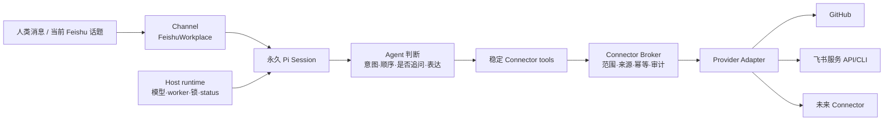

# Mochi 连接器与 Agent 运行时架构

日期：2026-09-29。

本文是 Mochi 从“GitHub + 飞书群的专用实现”演进为开放连接器系统的目标合同。它定义对象、所有权、Pi/Agent/程序的分工、连接器工具 ABI、迁移顺序和验收边界。本文描述的是可落地的目标架构；在对应阶段完成代码、状态、端到端证据以前，不把目标能力写成当前已交付能力。

当前已经交付的永久 Pi Session、Pi JSONL、飞书群通道、GitHub 项目选择和 GitHub Issue 工作流仍遵循 [独立 Bot](independent-bots.md)、[Agent 服务合同](agent-service.md) 及 [产品架构](product-architecture.md)。本合同要求一次明确迁移，不保留一套长期并行的旧连接器路径。

当前落地状态：`src/connectors/` 有 manifest 校验、provider registry、目录 revision、`describe`/read/write 门禁、TaskGrant、稳定 Broker 错误码，以及 Broker 侧的写入幂等与 provenance ledger（`state/schema.ts` 的 `connector_write_ledger`）；由 `test/connectors.test.ts` 覆盖。**`BotApp` 现在构造 registry 并注册 `feishu-service` 与 `feishu-mail` adapter（`src/app.ts`），Broker 已进入生产路径**，目录通过 `connectorCatalog` 投影进 status。Pi ABI 增加了四个 provider-neutral 工具 `connector_catalog`/`connector_describe`/`connector_read`/`connector_write`（`src/agent/connectorTools.ts`，手写 spec 以绕过 `tool()` 的 `repository_id` 注入）。

飞书服务的真实能力边界以官方证明返回的完整 tenant scope inventory 为准；授权数量会随飞书应用配置变化，不能把某次历史绑定的数量写成永久合同。最近一次运行时目录实测为 41 项，分为群聊与消息 21 项、文档与知识库 11 项、机器人与组织 9 项；这些事实现在由连接器详情页按分类完整展示。`REQUIRED_LARK_TENANT_SCOPES` 是 Mochi 要求的**下限**，不是飞书授予的上限。scope 已获授予也不等于 Mochi 已实现对应操作：当前服务 adapter 只声明云文档和知识库读取。飞书机器人授权一次生效；资料能否读取由飞书里的分享关系决定。群消息中已分享的文档或知识库链接属于当前回合材料，由 Bridge 尝试送入 `material_read`；是否成功和内容是否完整仍以该回合的材料状态为准。只有要让某份已分享资料脱离当前消息、供后续消息继续使用时，才把资料固定进当前分身的连接器目录。已连接但没有固定资料时，`document.read` 与 `wiki.read` 对 `connector_read` 的目录状态是 `selection_required`（表示没有固定范围），不是服务“暂不可用”，也不是要求用户重新授权；只有连接本身失效或能力确实受限时才显示不可用。当前运行时目录没有 `base:*`，因此多维表格仍未接入。

当前飞书接口不会向这个机器人返回可用的完整资料目录：实测 `wiki +space-list --as bot` 与 `GET /open-apis/drive/v1/files --as bot` 均 `ok:true` 但结果为空，因为飞书是成员制而 `parseTenantScopeInventory` 丢弃 `scope_type:"user"`。因此详情页把“固定资料”作为可选的资料发现和跨消息范围确认入口，而不是第二次授权；用户只在要让某份已分享资料脱离当前消息、供后续消息继续使用时粘贴链接。当前消息里的已分享链接不经过这个入口。`drive +inspect` 对不存在的文档也返回 `ok:true`（仅 title 为空），**只解析 URL 形状、不证明访问权**，所以用于固定时链接必须紧跟一次真实读取，两者都成功才落库（`src/lark/serviceResourceResolver.ts`）。

**GitHub 也已收进同一个 Broker**：`GitHubConnector`（`src/connectors/github/adapter.ts`）与飞书 adapter 注册在同一个 registry，原始的 19 个 `github_*` 模型工具与 status 的 `github`/`githubProjects` 字段均已删除。桌面端的 `select_projects` 仍是闭合的项目选择命令，由同一个 GitHub 选择所有者执行。GitHub 的 18 个操作由 `src/connectors/github/operations.ts` 单一声明，manifest 由它生成，因此模型看到的 schema 与目录发布的 schema 不可能分叉。GitHub 的具体实现（`src/github/*`、12 个文件）仍是唯一的授权与传输实现，adapter 只做映射，不复制任何边界判断。

`feishu-service` 只声明只读能力：写入需要 authorization quote、幂等键与权威回读的完整合同，未实现前不声明。切换 ABI 需要一次显式 `runtime:session:migrate`（19 个工具名变为 4 个连接器工具，ABI 必然改变）。

### 飞书共享邮箱：独立的只读 Connector

`feishu-mail` 是独立 provider，不把邮箱混入飞书群 Channel 或 `feishu-service` 的文档/Wiki 资源。它使用当前 Bot 的官方 `lark-cli` transport，但显式以 `--as user` 证明邮箱用户身份，拥有自己的 connection id、邮箱资源选择、scope 要求和 capability manifest。用户授权和机器人身份分别验证；邮箱地址不会因为机器人能进群就自动获得访问权。

当前只声明 `thread.list` 与 `thread.read` 两个读取能力。manifest、reader 和 adapter 都没有发送、回复、转发、草稿、删除、移动、标签、已读或规则修改路径；adapter 的 `write` 也失败关闭。主题、发件人、正文和附件元数据全部标记为外部不可信输入，不能成为 Agent 指令或授权。资源必须先由官方 `accessible_mailboxes` 返回为公共邮箱（`PUBLIC_MAILBOX`），才会作为未选资源发布，再由用户在设置中选择；用户本人的主地址、别名和邮件组既不是选项也不能被保存，因此不会作为 Bot 事实进入状态。目标共享邮箱只能在真实用户可访问目录中被固定。

授权由 adapter 独占：发起前先用 `auth scopes` 核对飞书应用已开通的用户权限，缺少时直接引导到官方 scope-apply 页；发起后立即在后台轮询 device code，用户只需在飞书确认，复核身份与目录后自动发布，没有“我已完成授权”步骤。从未授权的 Bot 不发布邮箱连接（目录显示“未连接”），等待中发布 `authorizing`，首个尝试未完成发布 `mail_authorization_incomplete`。BotApp 只在生效的飞书应用绑定变化时作废邮箱证明和飞书资料复核；替换候选的注册与检查不会使它们失效。授权 URL/device code 只在内存中短暂存在。实验与验收边界见 [飞书共享邮箱连接器](feishu-mail.md)；真实邮件读取仍需用户完成最小只读授权，不能以 fixture 代替。

安排通过同一四工具面发布宿主内部 `mochi-schedules` 数据能力；它不需要外部账号，不进入 companion 的外部连接器目录，也不产生第五个 Bridge tool 或 ABI 迁移。当前人类可管理安排；定时回合只看到创建时明确绑定且当前仍授权的只读资源，不能管理安排或修改外部服务。时间与交付的权威在 Bot 的 SQLite/dispatcher，详见 [安排合同](schedules.md)。

## 1. 先把五类对象分开

“连接器”不能成为所有外部或内部能力的总称。Mochi 需要五个互不替代的对象：

| 对象 | 定义 | 例子 | 所有者 |
| --- | --- | --- | --- |
| Agent | 解释当前请求、选择能力、组织步骤和表达结果的模型运行 | 判断是否需要查 Issue、是否需要追问、如何汇总依据 | Pi Session + 当前 Agent turn |
| Connector | 对外部服务的受限适配器，提供账号、资源和闭合能力 | GitHub、飞书文档/Wiki，以及完成合同后接入的 Bitable、Linear、Notion | Bot 的连接状态、资源选择和 provider adapter |
| Channel | 接收和交付对话的入口，负责事件、线程和回帖 | 飞书群 | Bot 的 `FeishuWorkplace`、话题和消息幂等 |
| Host runtime capability | 为 Agent 提供模型、进程、Session、锁和状态的宿主能力 | ChatGPT OAuth、命名模型 API、Pi worker | 宿主共享账号与 Pi runtime |
| Skill / instruction | 工作方法和语言约定，不授予权限 | `AGENTS.md`、连接器调查方法 | Bot 的策略配置；代码能力合同优先 |

GitHub 是当前最重要的团队共享上下文连接器，但不是连接器协议，也不是 Mochi 的唯一外部来源。飞书群是消息通道，不应伪装成普通 CRUD 连接器；已实现的飞书文档/Wiki 以及未来完成各自合同的服务操作才进入连接器目录。BYOK 和 ChatGPT 是宿主模型连接，不能因为底层也使用 provider 就显示为外部连接器。

## 2. 目标分层



目标结构只有一个跨 provider 的中间层：`Connector Broker`。它不实现 GitHub 或飞书业务，也不把 provider 的 HTTP 细节暴露给 Agent。每个 provider 只实现 `Provider Adapter`，由注册表声明其资源类型、能力 schema、授权范围和回读规则。`BotApp` 负责组装 Bot 和生命周期，不再知道每个 provider 的工具分派细节。

### 2.1 Connector 的最小领域模型

```text
ConnectorProvider
  immutable providerId, displayName, version, resourceTypes, capabilities

ConnectorConnection
  Bot-owned connectionId, providerId, accountSummary, lifecycle, grantedScopes

ConnectorResource
  provider-defined stable resourceId, displayName, selected, owner/visibility,
  writable (when the provider can prove it)

ConnectorResourceScope
  one atomic durable range: selectedCount, proof status(ready|checking|unavailable), problem

ConnectorCapability
  capabilityId, operation(read|write), resourceSelection(required|optional),
  inputSchema, bounded provider result, sideEffect, requiredScope, idempotency,
  readback contract

TaskGrant
  botId, connectionId, resourceId, capabilityId, sourceMessageId,
  topicKey, requesterId, authorizationQuote, catalogRevision
```

`connectionId`、`resourceId` 和 `capabilityId` 都是不透明稳定标识。Agent 不传 owner/repo、任意 URL、HTTP method、header、token 或文件路径来“拼接”能力。显示名称、账号摘要和资源名称只来自已验证目录；目录失效时不能使用旧的展示名称猜测权限。

连接生命周期还必须把“需要用户补齐或重新授予授权”和“provider 暂时无法确认”分开发布：前者使用 `reauthorization_required` 并给出明确恢复动作，后者才使用 `unavailable`。这个判断由 provider adapter 根据已验证的失败原因完成，renderer 不从自由文本猜测；`resourceScope` 仍单独描述固定资源的复核状态，不能把资料范围问题升级成账号授权问题。

每个 capability 必须声明：

- 读或写，以及是否有外部副作用；
- 所需 scope 与资源类型；
- 输入的闭合 schema；输出必须是有界 JSON，语义结构由 provider capability 自己定义；
- 幂等键如何构成；
- 成功以后必须从 provider 回读什么；
- provider 限流或暂时性失败时是否允许一次有界、可观测的重试；没有声明就不重试，也不静默换路径；
- 可恢复错误、不可恢复错误和明确的用户恢复动作。

能力声明是代码合同，不由描述文字、Skill、MCP annotation 或模型自行扩大。当前 Broker 对输出统一执行 JSON 类型、深度和字节上限，但还没有跨 provider 的输出 schema 校验；因此 adapter 必须把自己的输出结构视为内部合同，并在能力描述中说明关键字段。provider 的实现可以是官方 API、官方 CLI 或受限本地 transport，但实现方式不改变 capability 的安全边界。未来补充输出 schema 时必须一次性替换这条 bounded-result 合同，不能同时维护两套输出权威。

“资源选择”在实现层是一个统一的 `selected` 标记，在能力层由 `resourceSelection` 明确说明是否必须有持久选择。`selected=true` 只表示 Mochi 保存了这项持久范围；当前能不能调用还要看 `resourceScope.status` 是否为 `ready`，以及 capability 是否适用于该资源。`resourceSelection=required` 表示没有持久选择就不能调用该能力；`optional` 表示 provider 另有一个有界的当前上下文路径，持久选择只是让同一资料跨消息继续可用。`resourceScope` 对一个连接的全部持久选择做原子复核，因此复核中的固定资源仍保留在目录中，方便用户查看或取消固定，但 Broker 在 `checking`/`unavailable` 时拒绝该连接下的目录调用。GitHub 的 selected repository 是必须的调用范围；飞书的 selected document/wiki 是可选的跨消息固定范围，当前消息里由 Bridge 送达的资料不需要 selected。`selection_required` 只描述连接器目录调用缺少固定资源，不能被翻译成账号未授权或服务不可用。

## 3. Pi、Agent、Bridge 和 provider 的职责

| 决策或状态 | Agent 判断 | 程序强制 |
| --- | --- | --- |
| 这是查资料、追问、总结还是推进工作 | 是 | 否；程序只提供可用能力和事实 |
| 选择 GitHub、飞书服务或未来连接器 | 是，根据目录和当前请求 | 能力必须来自当前 Bot 的已授权目录 |
| 多个结果如何比较、是否复用 Issue、如何措辞 | 是 | 不用关键词猜任务状态 |
| 是否向用户询问补充信息或授权 | 是 | 缺少必要事实或授权时拒绝执行，并说明缺口 |
| provider、账号、资源和 scope | 否 | 连接器注册表、Bot 状态和 provider authority |
| 输入 schema、资源边界、来源身份 | 否 | Broker 精确校验；乱序、未知或跨 Bot provenance 失败关闭 |
| 外部写入、幂等和远端回读 | 否 | capability 的 typed mutation、审计和 readback |
| 密钥、token、Session、队列和压缩 | 否 | 宿主、隔离 worker、连接目录和 Pi SDK |
| 飞书事件、话题、回应表情和回帖 | 否 | `FeishuWorkplace`、消息幂等和当前 channel contract |

用户此前确认的“让模型判断是否需要确认”保留：Agent 不再有固定的“高影响操作先确认”死流程。这个自由不等于程序把安全交给提示词。程序仍强制：当前消息来源、Bot、话题、已选资源、能力 schema、授权原话、幂等和回读。授权原话必须是当前消息的精确片段，并至少含 `CONNECTOR_AUTHORIZATION_QUOTE_MIN_CHARACTERS`（4）个字母或数字，消息更短时整句引用；GitHub Issue 写入的原话若写出 Issue 编号，目标必须是其中之一，没写编号时目标由 Agent 依据证据选择。原话只证明引用的证据真实且有实质，不证明意图；疑问句不应触发写入由 Agent 评测覆盖，程序不用关键词猜意图。执行预算是每条用户消息最多 10 次 `connector_write`（`src/agent/tools.ts` 的 `CONNECTOR_WRITES_PER_MESSAGE`，超出返回 `write_budget_exhausted` 并记录 `connector.write.budget_exhausted`），以及 payload 大小和 turn 时限；它们都不是额外的确认问题。用户已经在当前消息中明确要求创建、编辑、关闭、分配等动作时，Agent 可以直接调用；没有足够明确的意图时，Agent 自己追问，Broker 不替它编造确认。

### 3.1 Pi runtime 的稳定接口

Pi 继续拥有永久 Session、steer、one-at-a-time、自动压缩和 worker 生命周期。连接器不进入 Pi worker 的凭据环境。迁移后的 Agent tool ABI 固定为跨 provider 的闭合工具集合：

| 工具 | 用途 | 写入 |
| --- | --- | --- |
| `connector_catalog` | 返回当前 Bot 可见的连接、资源、能力摘要和目录 revision | 否 |
| `connector_describe` | 按目录中的 opaque ID 返回一个 capability 的完整 schema、当前消息请求授权和回读说明 | 否 |
| `connector_read` | 调用当前目录中的一个只读 capability | 否 |
| `connector_write` | 调用当前目录中的一个 typed write capability，并带当前消息的授权原话 | 是 |

这不是一个可以传 `url + method + body` 的万能工具。`connector_read` 和 `connector_write` 的参数只允许 `connection_id`、`resource_id`、`capability_id`、有界 `input`、`catalog_revision` 及写入所需的 `authorization_quote`。Broker 根据注册表再次解析 capability 和 schema；任何未知 ID、额外字段、跨资源调用或 revision 过期都失败关闭并要求重新读取目录。

拒绝以 `ConnectorError` 表达，工具层把它作为失败结果 `{"error":{"code","message","field?","provider?"}}` 交给模型：`code` 是稳定的分支依据；`field` 指出要改的路径，如 `input.issue_number` 或 `authorization_quote`；`provider` 只在 provider 拒绝请求时出现，含 HTTP status、provider 错误码，以及 4xx 响应中经过净化、有界的 `message` 与 `errors[].resource/field/code`，去掉 token、URL 凭据和 query，5xx 正文不读取。adapter 无法归类的异常仍是不透明的 `adapter_failed`，原因只写入 `connector.adapter.failed` 日志。

目录只返回能力摘要和每个 capability 的 manifest revision；完整 provider-specific JSON schema 由 Agent 按需调用 `connector_describe` 获取。这样常规 turn 的目录体积和模型判断成本不会随 schema 细节线性膨胀，而 schema 变化仍会使 revision 失效。目录和 read/write 结果都有明确字节、深度和数量上限。新增一个连接器或资源不会因为新增几十个函数而改变 Pi tool ABI，也不会静默 fork 永久 Session。只有稳定工具 schema、Broker 协议或 provenance 合同变化时，才增加 ABI 版本并走显式 `runtime:session:migrate`。

这里明确拒绝两种极端方案：为每个 provider/capability 生成一组函数会让模型更容易调用，却会让每次连接器更新都膨胀 ABI、触发 Session migration；单一 `connector_call` 加任意 JSON 又会把能力边界、审计和模型可理解性压扁成一个万能入口。稳定的目录、按 capability 描述的 schema、读写分离和 Broker 二次校验同时保留了模型判断空间与程序边界。

原先 19 个 GitHub 工具的类型安全没有消失：它们的输入校验、仓库 capability、Issue typed mutation 和 authority readback 现在是 GitHub adapter 的 capability registry。对模型来说，能力从硬编码函数名变成目录中的闭合 typed capability；对程序来说，安全边界仍然比自然语言严格——`GitHubRepositoryAccess.request` 只在已声明的 capability 内部使用，绝不外露。

### 3.2 不把目录变成第二份状态

连接器目录是由 immutable provider manifest、Bot 连接状态和已选资源实时投影的结果，不写入 Pi JSONL，也不让 renderer 自行拼装。SQLite 保存连接引用、资源选择、目录 revision、授权和审计所需的稳定事实；密钥只存在连接模块或共享账号 worker 能读取的私有存储；status 只发布可安全展示的摘要。

新增资源、撤销授权或 provider 失效不会替换永久 Session，也不会删除对话历史。当前 turn 使用它开始时取得的 `TaskGrant`；授权在 turn 中失效时，后续调用必须失败关闭，不能用旧 token 重放。

## 4. 飞书群与飞书服务必须是两条路径

### 飞书群：Channel

`FeishuWorkplace` 继续拥有官方事件流、群成员目录、回应开关、`thread_id` 话题、`@Bot` 激活、后续免 @、消息幂等、材料水合、回帖和 reaction。群不是可由 Agent 任意读写的资源，消息也不自动变成 `connector_read` 的输入。当前所有群消息仍进入该 Bot 的同一个永久 Session，并保留现有来源身份和话题授权边界。

### 飞书服务：Connector

新增 `feishu-service` provider，按服务能力拆开注册：

```text
feishu.docs.read / feishu.docs.create / feishu.docs.update
feishu.bitable.read / feishu.bitable.create / feishu.bitable.update
feishu.wiki.read / feishu.wiki.create / feishu.wiki.move
```

以上只是 capability ID 的示例，最终以官方 scope、API 证据和实现合同为准。它们有自己的资源选择、字段 schema、分页、幂等和远端回读；不因为同属飞书就复用群的参与开关，也不把群开关显示为 CRUD 连接状态。若以后需要读群历史或发群外消息，必须单独设计 message capability 和授权，不从当前 channel 内部对象直接泄漏。

飞书账户在底层共享一次官方身份证明；用户不需要为文档或 Wiki 再次连接同一个账户，未来接入的服务也必须沿用这条已验证身份。“群通道投影”和“服务连接器投影”仍是两组独立的运行能力：它们分别报告自己的 adapter、资源和回读状态，账户撤销则按统一授权事实同时失效。一个服务能力失败不能伪装成群断线，群事件流失败也不能宣称文档读取不可用。

## 5. 状态、凭据和控制面

| 层 | 唯一权威 | 允许保存什么 |
| --- | --- | --- |
| Immutable resources | `Resources/connectors/` provider manifest、schema、版本和固定 endpoint 合同 | 代码、scope 名称、能力 schema；不保存客户 token |
| Bot state | `Bots/<botId>/State/bot.sqlite` | connection/resource 引用、选择、目录 revision、幂等和审计事实 |
| Connector connection | `Bots/<botId>/Connections/<provider>/...` 或 provider 指定的隔离账号 worker | 官方凭据、短期 token、provider cache；权限最小化 |
| Pi history | `.pi/mochi/bots/<botId>/sessions/` | 只有对话历史和 Pi JSONL |
| Task grant | 当前 turn 内存、必要的最小审计 | source message、topic、requester、授权原话、capability/resource |
| Fleet status | `status.json` 的 Bot projection | safe account/resource 状态、闭合 problem code；不含 token、Session ID、原始错误或路径 |
| Host model account | `.pi/mochi/account/` 及共享账号锁 | ChatGPT OAuth 或命名模型 API；不进入 connector catalog |

控制面只增加闭合的 provider-neutral 动作：列出连接器、开始/取消/激活连接、选择/取消资源、断开、请求复核和查看能力。renderer 不能发送任意 endpoint、headers、provider 配置、token、路径、Session 或 transcript。provider-specific 的注册流程由 adapter 自己拥有，仍需在控制协议中以明确 schema 暴露，不能通过泛化 RPC 绕过门禁。

连接器目录的展示至少要让用户看见：provider、账号、已选资源、可读/可写能力、授权范围、最近状态、断开影响、恢复动作和实际活动记录。GitHub 可以显示“推荐团队上下文”；这只是产品排序和解释，不是特殊的系统层。飞书群显示“消息入口”，已接入的飞书文档/Wiki 显示普通连接器，尚未接入的服务只在限制说明中出现。模型连接放在宿主运行能力区。

## 6. 迁移方案：一次切换，保留 Session 身份

迁移不通过第二套兼容工具长期拖住设计，也不删除 Pi JSONL。顺序如下：

### 阶段 A：合同和注册表（只读）

新增 connector domain types、provider manifest 校验、canonical registry digest、目录投影和 Broker 接口。先把 GitHub 现有项目选择、scope、Issue capability 映射成 registry snapshot，但暂不改变 Pi tool ABI。完成 unit tests、状态投影和 renderer 只读展示后再进入下一阶段。

### 阶段 B：GitHub adapter 收口

把 `AgentToolExecutor` 的 GitHub switch、`GitHubProjectSelection`、Issue workflow 的 provider 调用收进 `github` adapter 和 Broker。`BotApp` 只注入 `ConnectorBroker`、`FeishuWorkplace` 和 runtime；它不再按工具名称分派 GitHub。旧 19 工具只能作为这次迁移前的离线验证输入，不能作为新产品的第二条运行路径。

### 阶段 C：稳定 Pi tool ABI 切换

发布明确的 `runtime:session:migrate` 维护动作，把旧 `github_*` ABI 迁移到四个稳定 connector tools。迁移遵循现有 Session 合同：取得 Bot 空闲 admission，读取同一永久 Pi JSONL，完成无工具 bootstrap、独立 resume 复验和 capability ABI 原子晋升；失败保持旧 binding，不替换、不截断、不静默 fork。迁移完成后新 turn 只使用稳定 ABI，旧协议不再恢复。连接器表现属 SQLite schema 9 的建库定义；早先 schema 7 到 8 的连接器表迁移已随 0.2.0 之前的开发数据迁移移除，其他 schema 失败关闭且不改写。

### 阶段 D：飞书服务只读能力

**已交付** `feishu-service` provider 的 `document.read` 与 `wiki.read` 两个只读 capability（`src/connectors/feishu-service/`）。飞书机器人授权沿用首次连接取得的 scope，不再次要求用户连接；资料对象由飞书分享关系决定是否可读，当前消息材料直接走 `material_read`，固定资料才通过连接器目录供跨消息 `connector_read` 使用。当前目录接口不提供完整枚举，因此“固定资料”只是在需要时用链接完成对象确认，不是第二次授权。多维表与写入 capability 未声明。主访问范围只展示 manifest 已接入且已获授权的能力。多维表格与写入的实现限制在连接管理中说明，不把额外 scope 当作已实现能力，也不提供没有实现支撑的申请入口。

### 阶段 E：typed writes

每个 provider 的写入能力单独定义 authorization quote、幂等键、远端 readback、重复候选处理和审计字段。GitHub Issue 原有 `create/edit/comment/assign/...` 迁为一个 provider capability 的 typed action union；模型是否需要追问仍由 Agent 判断。飞书 CRUD 的写入不复用 GitHub Issue 审计表，除非未来抽象出同样严格且不丢语义的跨 provider audit contract。

### 阶段 F：目录化 UI 和移除硬编码

**UI 已完成**：连接器页是一张目录，GitHub 与飞书是 peer，已连接与否是状态而非分区；两个连接器各有子页与 `连接器 / <provider>` 面包屑，共用同一骨架；飞书服务页把“机器人服务授权”“当前消息直读”“可选固定资料”和“连接器操作”分开呈现，没有固定资料时不会自动打开链接输入框。固定资料的持久范围在复核中仍可见并可取消；`resource_checking` 与 `resource_unavailable` 只限制调用，不把连接改写成未连接。

连接器目录的卡片字段已经收敛为三组稳定概念：**连接身份**（使用哪个账号或机器人）、**访问范围**（这个连接选中了哪些对象）和**可用操作**（对这些对象当前能读取或更改什么）。GitHub 的 repository、Gmail 的 mailbox/label/message、Drive 的 folder/file、Notion 的 page/database 都是访问范围中的 provider-defined resource type；它们不能再被提升成页面字段（例如“项目资源”或“服务资源”）。同一 provider 的多个账号按 `connectionId` 分成多张卡，不能合并成一张 provider 卡。连接状态、访问范围和操作状态彼此独立：能读取邮箱不表示能发送邮件，能访问 Drive 文件夹也不表示能修改文件。

Gmail、Google Drive、Notion 等未来 provider 只需实现自己的 manifest、连接生命周期、资源选择和 capability adapter，就会进入同一目录投影和同一张卡片，不复制 JSX 或另起一套字段。它们在真实 adapter、授权和可回读能力落地前不进入当前连接目录，也不显示成“未连接”的假接入；当前测试中的 Gmail/Drive/Notion 仅是 projection fixture，用来证明类型和操作边界可以承载未来 provider，不代表产品已经接入这些服务。

**已完成**：`BotApp` 组装 registry 并注册两个 provider；status 只有一个 `connectorCatalog` 投影，GitHub 与飞书的事实都由它承载；桌面端需要的 provider 形状（连接状态、账号、项目列表）由 `controlApp/src/shared/connectorView.ts` 从该投影派生，不再有第二份发布的 GitHub 事实。

### 详情页与授权呈现协议

详情页有三个感知分组：**当前连接 → 访问范围与对应操作 → 连接管理**。身份与状态紧邻服务标题；恢复入口留在同一连接区。已保存的内容是默认视图，范围及其可用操作放在同一区域；授权方式、官方授权管理、实现限制与断开属于管理区，通常折叠。飞书服务同时需要解释完整授权清单和与群聊共用的机器人，因此由自己的页面将这个管理区默认展开，但仍保持一个分组和同一套连接生命周期。`ConnectorDetailPage` 拥有共同层级与排版，`ConnectorOperations` 只展示当前 catalog 的能力，provider 页面拥有实际流程。亲近性、共同区域与相似性按对象和后果组织，不能因为同为按钮或字段就放成同权重的一组。

GitHub 进入行内编辑后搜索、勾选、一次保存，放弃更改回到原范围；飞书在默认状态先说明机器人服务授权与当前消息直读的关系，“固定资料”才进入链接验证，验证成功即刻生效，不增加第二次保存。没有资源时 GitHub 展开选择入口，飞书保留授权已生效的空状态并把固定入口作为次级动作。复核中的飞书固定资源继续显示已保存内容；用户可以先取消固定，新增固定资料需等当前范围复核完成。失败保留原对象与草稿，移除失败紧邻该项；成功后回到已生效内容与发起入口。工作中可以阅读、搜索、勾选或填写草稿，提交与断开继续要求空闲。未连接、授权中、明确需要重新授权、暂时无法确认、无资源、无搜索结果、未保存、同步中与失败分别表达。

授权差异在 `connectorAuthorization.ts` 归纳为四个有限维度，声明随 `connectorDirectory.ts` 的 provider 呈现元信息维护，不建立第二个账号状态机：

| 维度 | 闭合类型 | 含义 |
| --- | --- | --- |
| 身份取得 | interactive（redirect/code/qr）、secret、inherited、public | 官方交互、安全凭据、沿用已验证连接或无需登录 |
| 授权主体 | user、application、user_and_application、service_account、public | 权限授给谁；登录人与执行身份可以不同 |
| 资源限定 | message_context、provider_selection、catalog_selection、explicit_reference、account_scope 的有序组合 | 当前消息材料、官方授权选择、Mochi 目录选择、明确链接、账号范围；不是单一互斥枚举 |
| 管理员审批 | none、possible | 是否可能需要组织审批；当前审批是否完成只能来自 provider 事实 |

GitHub 是 redirect + user_and_application，资源先经官方授权再经本地目录选择；飞书服务是 inherited + application，当前消息材料按 message_context 读取，资料是否可读由飞书分享关系决定，明确链接只用于在需要时验证并固定跨消息范围，机器人源连接使用官方 QR 流程。未来 Gmail/Drive 可由官方交互、用户主体及真实的目录/账号范围组合；Notion 可由官方交互与服务端页面授权组合。这些是呈现协议能承载的归纳，不是已上线服务，也不承诺尚无证据的具体权限。新机制若无法无损表达必须扩展闭合类型与实现，不能塞进字符串或泛化 RPC。执行与凭据仍归各 provider 连接所有者。

当前事实继续来自 `connectorCatalog`：飞书 scope 与机器人名称由 `proveFeishuConnection` 的官方证明传到 runtime binding，再进入服务目录，不从 manifest 反推额外授权。每个 provider manifest 声明的能力都会进入目录；`authorization_required` 表示该能力已实现但缺少它声明的 scope，目录中没有该能力才表示当前 adapter 没有声明它，不能借此推断 provider 的全部授权范围。`resourceScope` 单独记录持久范围的 `ready`、`checking`、`unavailable`；`connector_read` 只有在范围为 `ready` 且存在适用的已固定内容时才显示为 `ready`。`resource_checking`/`resource_unavailable` 是固定范围复核状态，不是重新授权提示；没有固定内容时的 `selection_required` 只表示连接器调用缺少固定范围，不能翻译成飞书服务不可用。当前消息材料的读取由 `material_read` 另行证明。目录未确认不能显示未授权。renderer 不自行维护 scope 门槛；未接入服务只在管理说明中交代。飞书扫码、审批、发布与候选切换继续由同源 `FeishuConnectionPanel` / `feishuPresentation` 拥有，服务页返回该流程，不复制状态机。

Status 28 用闭合 `availability` 替代能力的 `ready` 布尔值：`ready`、`selection_required`、`resource_checking`、`resource_unavailable`、`authorization_required`、`read_only`、`access_unconfirmed`、`connection_unavailable`。唯一推导者为连接器层的 `connectorCapabilityAvailability`，UI 与 `connector_catalog` 共用：连接已就绪、所需 scope 已获授予、资源范围已复核且选中适用资源，写操作还必须有明确 `writable: true` 的适用资源。`authorization_required` 表示能力已经在 manifest 实现，但 provider 尚未证明它声明的 scope；这与“manifest 没有该能力”、`selection_required`、连接故障分别表达。对需要目录资源的 `connector_read` 来说，未固定资源就是 `selection_required`；当 `resourceSelection=optional` 时，飞书详情页和模型目录把它呈现为“可选固定”，并同时说明当前消息材料的直读路径。未知写权限不能算可用，已知只读不能误称待选择；renderer 与模型只翻译结果。此状态证明目录层面的可用性，不替代每次执行的实时授权与空闲门禁。status 旧形状直接拒绝，不增加兼容路径；control 仍为 22，工具 ABI 不变。

Status 28 的未选资源以 `selectionId: null` 明确表示没有连接器调用权，已选资源必须携带真实选择身份；复核失败时仍发布已保存的 selected 行，但 `resourceScope` 使它们不可调用。GitHubProjectSelection 缓存最近完整的官方目录证明并绑定 account/grant，另从当前账号的持久选择记录提供只读展示快照；证明失败或授权变化后不发布旧候选，展示快照也绝不恢复调用权。GitHub adapter 只读取这两种内存/本地快照，不在每次工具调用时访问网络。目录同时呈现可选与已选项目，Broker 仍只接受 selected、范围已复核且写入资源明确 `writable: true` 的资源；能力是否已接入由 scope 与 manifest 决定，GitHub 当前是否可用再由已选项目决定，飞书当前消息材料则走独立的 material path。

Control 24 增加 `remove_connector_resource` 以及飞书邮箱授权管理命令；Control 25 删除已无用途的 `complete_feishu_mail_authorization`（授权在 Bridge 后台完成），并增加只返回邮箱 scope-apply 页的 `feishu_mail_settings` 和断开邮箱授权的 `disconnect_feishu_mail`。Control 26 删除 `refresh_feishu_mail_connection`。Control 27 删除 `refresh_groups` 与 `refresh_projects`，把只用于替换候选的 `refresh_feishu_connection` 改名为 `check_feishu_candidate`，并增加 `recheck_connections`（见下文“连接复核”）。资源移除只接收 botId、connectionId、resourceId 和 selectionId，Bridge 在空闲 admission 内拒绝过期选择、跨连接和未知资源，持久移除后发布目录，宿主按选择语义读回：目标不再被选择（带已证明目录的 provider，例如邮箱，会把它保留为未选选项），已选数量减一，其余选择的资源与选择身份原样保留；追加时只比较已选资源，未选选项变为选择不算破坏原有范围。追加操作以 adapter 成功证明链接读取，并读回旧选择完整保留；重复添加保留选择身份。UI 失败保留链接、草稿按 Bot 隔离、忙碌时禁止重复提交，操作不删除飞书文档或改变永久 Session。

### 连接复核

页面没有刷新或“重新检查”按钮：每个 Bot 自己保持连接事实最新。`BotApp` 在启动完成后每分钟复核一次，用户回到 Mochi（主窗口或设置窗口获得焦点）时宿主发送 `recheck_connections`，Bridge 立即应答并在后台复核；距上次复核不足 10 秒的请求视为已回答。同一时间只有一次复核，依次为：

1. 飞书机器人连接：`FeishuConnection.recheck()` 静默重新证明，不发布“正在确认”、不替换当前证明。飞书暂时没有回应（`provider_unavailable`、`provider_response_invalid`）不算答案：正在工作的 Bot 以实时事件流为准，已知的权限问题也保持原样。只有身份、可用性、权限范围或名称真的变化时，才经与连接相同的空闲 admission 应用（期间暂停 Bot、拒收新事件）；Bot 正忙时记录 `feishu.connection.recheck_deferred`，下次空闲时再应用。启动时证明失败（例如网络尚未就绪）的连接由此自动恢复，不再停在离线状态。
2. 群目录：`FeishuGroups.refresh()`，未知群的新事件仍会当场重新证明成员关系。
3. 连接器：只复核尚未证明的飞书固定资料（已证明的范围不动，避免复核期间关闭正在运行的工具）、已授权的邮箱目录，以及有账号的 GitHub 项目目录。前后目录相同则不发布、不记录；变化时记录 `connectors.rechecked`（只含 provider、状态和问题码）并发布。

每一步的失败由各自连接器记录并通过目录显示，下一次复核再问；整次复核的意外失败记录 `connections.recheck_failed`。宿主的复核请求不独占、不发布忙碌态，所以界面不会变暗或等待。替换候选（新飞书应用）仍由用户在飞书完成一步后点“检查并继续”（`check_feishu_candidate`），因为那是用户确认的下一步，而不是刷新。

连接生命周期由 provider 独占：控制协议中的 `start_github_login`/`cancel_github_login`/`disconnect_github`/`select_projects` 对应 GitHub 的 OAuth 与选择流程，飞书连接对应官方扫码和机器人验证。共同呈现协议归纳这些差异，不负责执行授权；只有出现第二个具有相同执行合同的 provider 时，才抽取共用生命周期动作，不能提前建立泛化 RPC 或第二个状态机。

每个阶段都必须先完成本阶段的真实边界验证，再进入下一阶段。新增 connector 不应修改永久 Session、消息 channel、模型账号或另一个 provider 的授权；若必须修改稳定 ABI，必须走显式迁移，而不是增加隐藏兼容路径。

## 7. 代码落点与应删除的技术债

目标目录职责如下：

```text
src/connectors/
  registry.ts          immutable manifest + capability registry
  broker.ts            catalog/read/write + provenance + idempotency
  protocol.ts          connector domain types and closed schemas
  github/              GitHub adapter and Issue authority client
  feishu-service/      Feishu Docs/Wiki adapter
  feishu-mail/         Feishu user mailbox read-only adapter

src/lark/
  workplace.ts         channel/event/thread/reply/reaction ownership

src/runtime/
  client.ts            Pi worker/session/steer/compaction
  sessionAgent.ts      admission, queue, source identity and tool relay
```

实施时需要消除或收口这些硬编码，而不是再复制一份：

- `src/agent/tools.ts` 的 `READ_ONLY_TOOLS`、`ISSUE_ACTION_TOOL`、`AGENT_TOOLS` 和按名称 `switch`；
- `src/app.ts` 对 `GitHubConnection`、`GitHubProjectSelection` 和 GitHub Issue 的直接组装；
- `src/control/protocol.ts` 把 GitHub/Feishu provider 名称写死为顶层命令的做法；
- status 中只有 GitHub/Feishu 的特殊投影；
- 文档、设置和 UI 中把 GitHub 写成产品定义、把飞书群写成全部飞书能力的文案；
- 任何以 `provider + endpoint + method + headers` 为参数的泛化调用；
- 为兼容旧 ABI 而长期保留的第二套 Session、工具、数据库或授权表。

不应删除的边界：永久 Pi Session、Pi JSONL 唯一历史、飞书群的 at-most-once、源消息 provenance、GitHub authority、模型账号与外部连接器的分离、worker 不加载 ambient MCP/Skill/extension 的合同。

## 8. 验收矩阵

### Agent 和 Pi

- Agent 能从目录判断“查 GitHub Issue”“读飞书文档”“缺少资源需要追问”，而不是依赖 provider 固定 prompt。
- 增加一个 connector 后，稳定 tool ABI、永久 Session 和 Pi JSONL 不变；只有注册表目录发生变化。
- 同一话题 steering、跨话题排队、压缩、超时和重连继续通过现有 runtime 测试。
- 目录过期、能力未知、输入 schema 错误时，Broker 返回固定可恢复问题，Agent 可重新读取目录；不会重放写入。

### 安全与数据

- 错 Bot、错 connection、未选择 resource、错 topic、未知 sourceMessageId、过期 grant 都失败关闭。
- renderer、Pi worker、tool output、日志和 status 不出现 provider token、secret、任意 endpoint 或原始 provider 响应；provider 拒绝原因只以 §3.1 所述净化、有界的字段出现。
- model connection 永远不出现在 connector catalog；Feishu 群 channel 永远不被当作 Feishu CRUD resource。
- provider adapter 无法调用任意 HTTP method 或 URL；所有网络动作由已声明 capability 负责。

### 外部读写

- GitHub read 使用已选 repository capability；Issue write 继续要求 typed action、当前消息授权原话、幂等和权威回读。
- Feishu service read 使用已授予 scope 的能力证据、独立资源选择和当前资源复核；当前未声明 Feishu 写入 capability。服务失败不改变群参与状态，也不触发重复连接。
- Feishu mail read 使用显式 `--as user` 的最小邮箱只读 scopes、官方可访问邮箱目录和独立 mailbox 选择；当前没有任何发信或邮箱写入 capability。邮件内容只作为外部资料，不能触发操作。
- 撤销一个连接后，已有对话和 Session 保留；新调用明确失败，重新授权后恢复同一 Session。

### 产品体验

- 连接器详情显示 provider、账号、资源、能力、读写边界、状态、活动和恢复动作。
- GitHub 的推荐上下文、Feishu 群的消息入口、Feishu CRUD 的普通连接器是不同语义，不是三个互相竞争的顶层产品。
- 设置不承载 Agent 对话；当前任务中展示实际使用的 connector/resource 来源，避免用户重复解释上下文。

## 9. 明确不做的事

- 不把 GitHub 变成所有 connector 的父类或唯一入口。
- 不把 Feishu 群消息、文档、Bitable、Wiki 混成一个巨大 connector。
- 不把 BYOK、ChatGPT 或 Pi runtime 当作外部工作连接器。
- 不允许 Agent 或用户提交任意 URL、header、token、MCP server、shell command 来即时创造连接器。
- 不用固定关键词或固定“高影响操作先确认”逻辑取代 Agent 的上下文判断；也不让自然语言绕过程序的 typed authority。
- 不先做插件市场、通用工作流 DSL、多 Agent 调度或跨 provider 原子事务。它们在 capability、信任、回滚和审计合同成熟以前只会制造第二套权威。

最终目标不是让每个 provider 看起来一样，而是让它们共享同一套深而窄的边界：Agent 负责理解和选择，Broker 负责授权和事实，Adapter 负责 provider 语义，Channel 负责消息，Pi 负责持续记忆和运行。这样 GitHub 可以保持重要的产品推荐位置，同时不会限制 Mochi 接入下一万个连接器。
