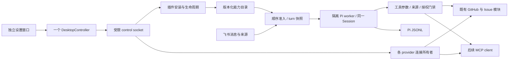

# Mochi：能力与设置架构

日期：2026-09-09。设计基线：`8bc1998188cc99f3db32c4efec865ac6917f22c9`，Pi SDK `0.87.1`，Agent Plugins `1.0.0`。

**A 阶段（独立设置、分身导航、真实领域数据与只读方法）已实现；B–F 仍是目标架构与实施合同。** 当前产品仍执行 [现行架构](../product-architecture.md) 和根目录 [AGENTS.md](../../AGENTS.md)。本设计不授权自动替换永久 Session、运行第三方程序或扩大客户授权；这些行为的具体迁移必须依下文合同实现、核验。独立设置原型使用明确标记的模拟状态。

## 1. 产品承诺决定结构

麻薯帮助团队从已授权的项目信息中获得有来源的回答，并在明确授权后推进 Issue。用户应该知道：它怎么与我相处、怎样思考、在哪里回应、会做什么。增加一种能力不应让用户重新解释自己，也不应让一次连接失效变成整个产品失效。

设置承担长期调整；主窗口承担陪伴与当前工作状态；飞书承担实际对话和交付。不要让设置变成第二个聊天界面，也不要把主窗口变成管理控制台。

就绪也必须分层：内核就绪由组件验证、ChatGPT 和原 Session 恢复证明；渠道就绪由飞书连接与参与策略证明；任务所需能力由该插件及其授权范围证明。GitHub 插件停用或未连接，不使 Session 消失、不引导重新登录 ChatGPT，也不重放首次见面。麻薯要回答项目问题时才解释缺少的项目访问；“首次有用结果”仍要求实际带来源的回答，不能用连接成功代替。此分层是目标行为，需要与当前首次设置状态机一同落实。

借鉴 macOS System Settings 的是稳定导航、对象归属、渐进展开和原生窗口行为。用户于 2026-09-09 明确纠正：**设置不使用主窗口那块毛毡纹理作大背景。** 保留毛毡图标、柔软形体和克制的层次；背景与阅读区域保持干净。2026-09-10 用户进一步否定旧深色设置的蓝灰配色：深色以中性石墨灰和柔和白字组织界面，蓝色集中于可操作状态；随后明确希望加入优雅、轻微的透明与毛玻璃。材质用于侧栏和窗口边缘，正文保持稳定底色。品牌连续不等于复用整张场景背景。

## 2. 六个概念，各有一个所有者

| 对象 | 本质 | 用户接触的方式 | 权威与不变量 |
| --- | --- | --- | --- |
| 角色 | 一种工作承诺；麻薯目前专注 GitHub 团队协作，Awawa 与 Kiwi 目前先作为独立形象 | 认识角色、与它相处，并在 Bot 设定中选择 | 产品定义；motion manifest 只拥有外观和播放，不存能力、账号、权限 |
| Session | 同一用户部署的持续记忆 | 连续对话；必要时整理上下文 | Pi JSONL；SQLite 只保存身份与运行证据，不复制对话 |
| 插件 | 可独立分发、启用和更新的一组相关能力 | 插件列表 → 详情 | 标准包 + Mochi 安装记录；身份不等于展示名称 |
| Skill | 完成某类工作的知识与方法 | 插件里的只读 Markdown 文档 | `SKILL.md`；不是权限声明，不是可执行程序 |
| 工具 | 可以执行的具体操作 | 通常通过任务结果理解；必要时查看能力范围 | 强类型 schema + 执行门禁；自然语言与 MCP annotations 都不授予权限 |
| 连接 | 账号身份以及用户授予的资源范围 | 在对应能力或渠道中连接、选择、断开 | 各 provider 的唯一连接模块；插件不复制 OAuth/token 存储 |

“所有 Skill 都作为 Plugin 分发”是合理的产品方向；“每份 Markdown 都是一个 Plugin”会制造空壳。一个插件可以包含多个 Skill，也可以只提供工具。独立 Skill 导入若将来需要，应显式包装为用户可检查的本地包，不能伪造作者与来源；本次不增加第二种安装格式。

`feishu-collaboration` 与 `message-contract` 属于基础输入/来源合同，留在内核。`github-investigation` 与 `issue-authoring` 中的方法进入同一个 GitHub 插件；其中授权、确认、审计规则仍保留于代码和核心协议。关闭插件不能关闭安全规则。

未来角色可以复用插件，但“同一插件”不意味着共用连接、资源授权或记忆。当前提供 Bot 设定中的显式形象选择；仍不增加角色市场、多 Agent 调度或通用工作流 DSL。Awawa 与 Kiwi 的形象及动效不代表已经定义了不同能力。

## 3. 设置的信息架构

当前 Settings 的第一栏选择「通用」或独立伙伴，第二栏显示该范围的分类。只有一位伙伴时没有可选的名单，两栏合成一栏：伙伴的身份与开关、它的五个分类、「通用」三个分类和「新增伙伴」依次排列。有多位伙伴且窗口不足 700 point 时，第一栏收成头像条，名字放进悬停提示。名单里的每个头像带状态点，状态词与菜单栏、伴随窗同源（`shared/vocabulary.ts`）。伙伴分类为 **设定、连接器、模型、群聊、安排**；设定集中名字、嘱咐与角色形象选择，连接器拥有各服务的身份、范围和操作。模型连接、帮助与诊断属于「通用」，值班开关与当前 Bot 名称、状态组成分类栏顶部的固定身份区；窄窗时该区域移到分类导航上方，失败也在开关旁说明。本文的标准插件加载与激活部分仍为未来提案；当前产品合同见 [独立 Bot](../independent-bots.md)。角色选择使用 manifest 中的独立根图，不改变连接、记忆、模型或工作范围。

```text
设置
├─ 通用
│  ├─ 模型连接              共用 ChatGPT 与模型 API
│  ├─ 运行诊断              宿主与各 Bot 的真实状态
│  └─ 使用帮助              指引与只读工作方法
└─ 每位 Bot
   ├─ 设定                 名字、嘱咐与形象
   ├─ 连接器               服务身份、范围与操作
   │  ├─ GitHub            项目与访问、只读工作方法
   │  ├─ 飞书服务          文档、知识库与固定资料
   │  └─ 飞书共享邮箱      独立用户授权与只读邮箱范围
   ├─ 模型                 所用连接、模型与深度
   ├─ 群聊                 飞书连接、所在群与回应开关
   └─ 安排                 查看、暂停、恢复与取消
```

子页在右侧内容区推进。返回是标题行的一部分：宽窗时一个「‹」按钮悬挂在标题左侧的页边距里，与标题同一行、垂直居中，标题仍压在阅读轴线上；窄窗没有可悬挂的页边距，改为标题上方写出去处的「‹ 连接器」。读屏名称与悬停提示写出要回到的位置（如「返回 连接器」），左侧导航的高亮说明所在分类；点击恢复该位置，不在标题里再写一遍层级，也不在窗沿放一个漂浮的返回控件；不把 Skill 展开到全局侧栏，不叠加第三栏，也不为每个层级开一个窗口。详情返回保留列表滚动、搜索词与选择；切换到其他全局页，再回插件，恢复当前阅读位置。

### 共同的排版与分组

设定、连接器、模型、群聊、安排，以及通用里的模型连接、诊断和帮助，共用同一个阅读框和六列网格。`settings-grid` 唯一声明六列与 16px 列间距；命名内容容器 `settings` 按实际可用宽度调整标签和内容跨度，避免侧栏宽度影响表单判断。内容不足 560px 时，字段由一列标签、五列内容改为两列标签、四列内容。主标题统一为 28px 字号、36px 行高，下方留 32px，标题下不再重复页面用途。三栏共用两条水平基准线：F1 是页标题的基线，左上字标与分类栏顶部的 Bot 名称落在同一基线；F2 是阅读面板第一条小节细线，范围栏第一项、分类导航第一项与它从同一高度开始。每个小节都以一条横贯阅读栏的细线起头，标题、右侧计数或操作与一句说明紧随其下；组内 8px，小节标题到内容 16px，小节之间 40px。细线标出小节从哪里开始，邻近关系把小节聚成一组。

`SettingsSectionHeader` 统一小节标题、右侧计数或操作与一句说明。小节标题与字段用 13px，次级说明用 12px / 20px；长名称在阅读内容中完整换行，不制造横向滚动。阅读面板是唯一外框，面板内只有一层对象表面：`SettingsList` 与 `SettingsRow` 是列表的唯一实现，行固定为前导图像、名称与说明、尾部控件三条轨道；同一列表的分隔线从文字列开始，让图像列保持连续；整行可进入时整行就是按钮。表面里不再嵌套色块、卡片或分隔框，小节和保存栏也不加边界。已确认的状态只用 `StatusMark` 的圆点加文字按语义着色，不用填充胶囊，避免状态被误认为控件。空、读取中和未知状态沿用同一阅读尺度，仍明确区分事实。

模型的来源、模型选择、思考深度和解释共用内容起点，保存状态与动作同组。连接器只解释一次目录用途。卡片的服务图标悬在左边距，名称、状态与入口组成身份行，入口在该行右端：已有连接写「管理连接」，未连接写「连接 GitHub」这类动作；核心连接器（GitHub、飞书服务）未连接时状态用琥珀色，可选的共享邮箱保持中性；连接身份、访问范围和可用操作各占两列，从名称的文字轴开始，窄卡片按原顺序叠放。群聊的连接身份、参与列表、工作方法分组各留 32px。参与列表没有刷新按钮，Bot 自动保持目录最新；切换中的群只在本行显示“正在更新…”，不插入额外提示行推动列表。安排把工作名称与状态放在同一行，时间和去向用共用标签列，展开内容保留完整宽度，暂停与取消仍作用于该记录。通用连接页只有一处主标题；连接列表、诊断事实和帮助说明沿用这些尺度。连接器详情与方法阅读也使用同一套标题、列表和操作轴线。

网格方法参考 [Müller-Brockmann 的 Grid Systems 出版资料](https://niggli.ch/en/products/rastersysteme-fur-die-visuelle-gestaltung)；上述列数、跨度和尺寸是本界面的实现选择，不改变连接、草稿、保存与授权的所有权。

### 相处方式：一张认真写字的纸

- 设定页直接显示名字输入和紧凑的三个形象选项，不折叠常用身份设置。名字未保存时在其标签旁标记，不另加摘要行。嘱咐占用剩余编辑空间，默认窗口无需先滚过形象选择。短窗口空间不足时，标题、身份设置和嘱咐共用同一个页面滚动区域；正文独立滚动且不向页面传递滚动，底部始终只有一处「保存嘱咐」栏。嘱咐标签旁只用一句「写下你希望它怎样一起工作」，紧接说明生效时机，并说明以 ## 开头的行是小标题。保存栏旁的「预览」只把草稿排版成阅读视图，编辑仍在同一个纯文本框里，不另设编辑器。在 640 × 540 下，单伙伴的合并侧栏让编辑框保有可用的高度。
- 设定页沿用共同网格：标题、身份标签、嘱咐标签、编辑框和保存状态共用左边界；名字输入、形象选择组和说明文字从同一内容列开始。三个形象在同一行均分选择组，窄内容区把预览与名字上下排列，最窄内容区让选择组占满六列。长名字完整保留在输入框里，未保存标记可换行。标签与编辑区、编辑框与保存操作之间各留 8px，正文行高 24px。身份组与嘱咐组各以一条小节细线起头，行标签就是小节标题，不另加「身份」大标题；保存栏不加分隔线。
- 角色名由 motion manifest 统一显示为 Mochi、Awawa、Kiwi；独立 Bot 的名字不随角色名变化。选择项显示 32px 预览和名字，角色介绍保留在悬停提示与可访问名称中，用 manifest 的可见轮廓统一预览尺寸与底线。卡片使用一层中性表面和轻量勾选，不叠加图片底框、阴影或黑色圆形徽章。形象选择即时提交，选中态仍只投影后台已确认的身份。更名独立提交，不由「保存嘱咐」代存。
- 字数、修改状态、保存按钮同一行；`⌘S` 与按钮共用保存事务。“从下一次任务开始使用”放在嘱咐标签旁的说明里，保存栏只承载状态与动作。不增加自动保存或“完成”第二提交动作。
- 同窗口切页、瞬时断线、打开诊断不清草稿。断线时仍可编辑；保存只在连接恢复后执行。revision 冲突保留本地草稿，提供核对已保存版本的明确动作。
- 原生关闭、`⌘W`、应用退出都先检查未保存草稿；默认保留窗口。只有确认放弃或保存成功才能关闭。强制结束进程无法保证草稿恢复，不声称已经持久化。

### 思考：把模型放回它的来源

- 顶部是当前模型连接行，显示该伙伴所用的 ChatGPT 或模型 API 来源及可靠状态，入口写「管理模型连接」；不编造 email、头像或套餐名称。账号动作在通用的模型连接页，不与模型并列成分身入口。
- 下面是模型与思考深度，继续消费 Pi 的真实目录；两项作为一个选择组合统一保存。思考深度的档位与顺序来自当前模型目录；展示名来自产品自己的闭合档位表（`REASONING_EFFORTS` 对应 `shared/vocabulary.ts` 的中文名，如“深入”“最深入”），内部 ID 不变，表外的值原样显示。模型名称由连接提供（如“ChatGPT · …”），不翻译。页面直接呈现胶囊轨道、圆形浅色滑块与内嵌刻度，当前档位放在轨道下方，不叠加下拉入口或浮层；主题蓝色渐变固定覆盖整条轨道，从浅到深对应当前模型的档位顺序，滑块逐步揭露相应区段，不能把渐变随填充长度拉伸、让每一档都以浓蓝收尾。轨道统一裁切填充，滑块在两端贴合，最低档不露出蓝色月牙；轨道和滑块用中性表面的细微渐变保留体积。刻度数量与顺序来自当前模型，支持拖动与键盘逐档选择。调整只更新草稿，由「保存设置」或 `⌘S` 提交；单一有效档位只显示该值，旧值不受支持时要求明确选择，不能静默替换。解释用户能感知的影响，不展示 provider ID、token 预算或实现参数。
- 当前任务继续使用原组合；成功读回后显示“下一次任务使用”。保存中只锁相关提交，导航和阅读继续可用。
- `unknown` 显示“账号状态暂时无法确认”，保留已保存值、当前草稿及已取得的模型目录，禁用依赖授权的提交；只有 `signedOut` 才显示登录。显式退出或进入切换登录才清除旧账号模型草稿与目录。目录失败不清空选择，不自动选择列表第一项。
- 账号切换沿用现有空闲门禁与原 Session 恢复检查；不因连接短暂失效重放 onboarding。

### 群聊：在哪里一起工作

- 顶部是已验证的飞书 Bot 身份与连接状态，正常时克制；扫码、组织审批、切换候选等过程只在需要时展开。在线只能由新鲜且进程匹配的事件连接证明。
- 正文是群列表：头像、完整群名、回应开关。数量足够多时出现搜索；当前小列表不为布局完整硬放搜索框。
- 连接行只显示实际 Bot 和连接状态；群列表显示总数与开启数，不重复连接文案。多于六个群时提供搜索，过滤不改变总数或后台参与策略。
- 群上方固定解释“开启的群共用{名字}的同一份记忆，就像同一位同事在几个群里。{名字}会注意分寸，不把一个群里的私事带到别的群。”（`sharedMemoryNote`，引导完成页用同一句），再说明新群默认开启、关闭回应只停止接收新消息；不是删除记忆或退出群。
- 开关等待后台写入与读回，失败保留原值并在该行给出恢复动作。正在完成的已接受任务不受群开关影响。
- `[]` 是确实没有群，显示邀请实际 Bot 的指引；`null` 是目录暂时无法确认，不能显示“还没有群”。

### 未来插件：先理解能力，再管理实现

- 当前外部服务通过连接器目录及各自详情呈现；标准插件仍是未来提案。未来目录按实际可用插件组织，不填充虚构能力或商店卡片。
- 详情页顺序：能力身份 → 连接状态与项目访问主入口 → 操作边界 → 次级工作方法 → 来源与版本。项目计数只从当前已选目录推导；未连接、授权中、目录未知和已连接未选项目分别呈现。完整项目管理与授权仍只有原来的一个所有者。
- GitHub 插件中的“项目与访问”复用当前连接所有者与项目选择事务。连接账号不自动选择项目；选项目不自动授权一次 Issue 写入；删除插件不声称撤销远端 OAuth。
- 包元信息、已安装状态与运行可用性分别保存，界面合并成一句可信结论。比如“已启用 · 需要连接 GitHub”“2 项方法可用 · 1 个工具服务未连接”，不能用绿色“已安装”冒充能执行。当前连接器的状态只由 `connectorStatusOf` 决定：连接在、但有能力缺授权时显示琥珀色“授权未完成”，不显示绿色“已连接”。
- 内置 GitHub 包随 Mochi 更新，详情显示“随 Mochi 更新”，不出现无效的独立更新/卸载按钮。启停只有运行时真的具备对应门禁后才显示。
- 第三方包的“启用”先列出新增能力与所需连接，授权完成后才激活；更新扩大操作范围必须再次确认。对不支持的运行方式如实显示原因，不把安装成功作为可用证明。
- 仅阅读的 Skill 没有编辑/保存按钮。没有按 Skill 拆分的开关：可独立启停的一组能力才值得形成另一个插件。

### 文档阅读

读取原始 Markdown，保留作者的标题、段落、引用、代码、表格和链接顺序。只解释标准 frontmatter；不从正文抽取“目标/输入/输出/步骤”，不要求作者迎合 UI。

内置工作方法默认显示三条面向群成员的要点（App 文案，由 `ui/Methods.tsx` 拥有），“原文”页签按顺序完整呈现给模型的协议正文。包中的相对文档/图片通过受限资源读取解析，目标仍在同一个已安装 revision 内；外部图片不自动加载。外部链接必须显示真实目标并经宿主允许的 HTTPS 打开动作；原始 HTML 不执行。缺失资源逐项提示，不隐藏原文。

阅读区最大约 68 个拉丁字符宽，中文采用同等光学行长；普通正文 14 px、约 1.7 行距是原型候选值，来自现有系统字体与 4 px 网格。代码/表格横向滚动只发生在各自容器，页面和返回导航不横向漂移。源文与渲染模式分别保留滚动位置。

## 4. 窗口与交互合同

设置是真正独立的原生窗口。初始为 1040 × 716 point，原生最小为 640 × 540；窗口超出当前屏幕可用区时由 AppKit 收拢。浏览器的 360 point 用例额外验证紧凑布局，不冒充原生最小尺寸。主窗口尺寸和角色播放不因打开设置变化。

| 入口/事件 | 必须发生的结果 |
| --- | --- |
| 主窗口设置按钮、菜单“设置…”、`⌘,` | 打开或聚焦同一个设置窗口；普通重开恢复路由 |
| 点击主窗口 ChatGPT/群摘要 | 同一窗口直达思考/群聊；显式路由覆盖最后路由，不覆盖草稿 |
| 插件 → 方法 → 返回 | 恢复插件详情的滚动与焦点，不重取整个目录 |
| 关闭设置 | 关闭这个窗口；主窗口和 Bridge 继续运行 |
| 关闭主窗口 | 设置继续可用；不得关闭共享 controller 或 provider owner |
| 后台短暂失联 | 设置仍可读，草稿仍可写；依赖后台的动作显示不可用 |
| OAuth 返回 | 原窗口就地更新；窗口关闭也不创建第二次 OAuth；不主动抢另一 App 焦点 |
| 主窗口预览 | 只影响预览窗口；设置打开时结束该预览后进入真实事实，禁止把样例当成设置状态 |
| 诊断 | 从设置内容区打开，返回保留草稿；不是新的全局功能或第三个常驻窗口 |

`host/main.ts` 保留一个 `DesktopController`、一个状态观察器。新增的窗口所有者只管理明确的 `companion` 与 `settings` 两个窗口槽，不建立泛化 window framework。每个槽有自己的订阅、ready、firstPaint、关闭代次和 pending navigation；一个窗口的迟到回调不能关闭或覆盖另一个窗口。

设置使用本地独立 renderer 入口，仍由同一 Vite 构建。窗口类型由宿主绑定 RPC，不能让 renderer 自报窗口 ID 来获得权限。`SettingsFrame` 只携带共享安全 snapshot 和一次性导航，主窗口继续消费已有动效/handoff frame。不为设置复制状态轮询或连接实例。

原生关闭要在允许销毁前处理 dirty 状态。已核对 Electrobun 2.0.1 的 `will-close` 与 `before-quit` 可取消事件：宿主同步拒绝默认关闭，再以五秒 deadline 请求 renderer 的最新 dirty/busy，默认取消原生放弃确认，允许后才调用官方 close/quit。实现不修改 SDK 或原生 delegate。未知编辑状态保留窗口；原生交互验收与浏览器检查分别记录。

React/Zustand 持有这个设置窗口的路由与草稿；不写 localStorage。TanStack Query 持有按需目录/文档读取且显式失效，不自动 retry、focus refetch 或跨账号保留。异步结果带请求时的窗口代次、连接代次与资源 revision；匹配失败即丢弃。原文不进入高频 status 或诊断。

焦点顺序遵循侧栏 → 内容标题 → 控件。鼠标或键盘进入详情后，返回都恢复发起行；跨分类保留子页及返回链，导航不抢编辑器焦点。窗口级 `⌘S` 只提交当前可见页中聚焦的表单；「设定」未聚焦表单时默认保存嘱咐，名字独立保存。各表单不复制快捷键监听；Esc 先关闭本地 popover/确认框，不关闭整个设置。加载期间保留内容骨架与标题；超过既有有界请求 deadline 后提供明确重试动作，不无限旋转。减弱动态效果时直接切换，不改变语义。

## 5. 设计 token 与视觉约束

设计 token 要保留语义和使用场景。`FeltSurface.tsx` 拥有主窗口的角色场景底材；它不是所有窗口的 wallpaper。`ui/style.css` 的基础表面、文字、focus 与排版继续服务设置；现有毛毡图标和品牌控件定义对象的触感。用户已明确拒绝将整个设置铺上 `MochiBlueTexture.png`，不得再以“保持品牌”为理由恢复它。

| 层级 | 采用什么 | 不扩展到什么 |
| --- | --- | --- |
| 大面积背景 | 两种系统外观均为暖纸白；侧栏和窄窗沿透出原生毛玻璃，内容面板不透明 | 不铺毛毡，不加程序噪点，不用整面蓝色渐变，不让桌面图案透进正文 |
| 能力身份 | 已审阅的蓝/奶白毛毡图标，清楚的体积、纤维与柔和边缘 | 不把每个系统符号、输入框和分隔线做成毛绒物体 |
| 选中与操作 | 导航用浅灰底与中等字重的深色文字；键盘焦点用 2 point 中性描边；主要操作和选中表单控件保留蓝色 | 不把导航、普通说明区都涂成操作色，不让禁用的按钮或行式动作保留主色或淡蓝 |
| 形体与层次 | 4 px 网格、现有圆角家族、hairline 和轻微接触阴影 | 不加大范围投影，不用粗边框模拟缝线 |
| 阅读与编辑 | 系统正文字体，圆角字体仅用于品牌字标；干净纸面与独立滚动，正文优先 | 不在长文后叠纤维，不牺牲对比度营造材质 |

设置、引导与日常伴随窗口共用一套暖白阅读主题。唯一颜色与排版所有者是 `controlApp/src/ui/style.css` 的 Tailwind theme，组件只消费语义，不自行定义色值。颜色按责任分工：

| 语义 | Token | 使用规则 |
| --- | --- | --- |
| 阅读与层次 | `surface/card/ink/muted/hairline` | 暖白承载内容，石墨灰建立文字层级，细线只分隔关联对象 |
| 位置与焦点 | `settings-selection/selected/focus` | 分类选中用浅灰底与深色字；键盘焦点是控件外 2 point 的 `focus` 描边，与选中、悬停的底色明显不同，不借用蓝色 |
| 动作与表单选择 | `primary/on-primary/action/action-soft` | 蓝色用于主操作、文字链接、已开启开关与勾选；`action` 是 `primary` 的别名，浅蓝只衬托可操作对象 |
| 说明与次要控件 | `note/control/field` | 说明、引用、行内代码及输入保持中性；普通说明不争夺操作色 |
| 已确认正常 | `status-good` | 深灰绿只用于已连接或已确认运行；账号图标保持固有材质色，未知、待授权与未连接不染绿 |
| 待处理、错误与静止 | `status-attention/error/status-idle` | 琥珀提示待处理（含未完成的授权、未连接的核心连接器），暖红标识错误或破坏性动作，灰色圆点表示非运行态；状态必须伴随文字，不只靠颜色传意 |
| 控件边界 | `control-boundary/field-border` | 开关关闭态的轨道与复选框边框约 3:1，输入框边框约 2:1，让控件在纸面上可辨认；不靠加粗或阴影 |

正常字号的正文、辅助文字、操作文字和状态文字在对应不透明阅读表面达到至少 4.5:1 对比度。禁用控件与纯装饰元素不冒充正文。飞书群、GitHub 组织或个人头像保留来源颜色，共用尺寸、裁切和加载失败占位；角色与毛毡资产保留自身配色，不随界面状态染色。原生菜单栏使用 AppKit 的系统语义色以适应 macOS 外观，由 `host/menuBar.ts` 决定状态含义，不复制 Web 色值。

侧栏的暖色透明层约为 12.5% 不透明度，分类选中态为 7% 中性深灰叠层，文字保持中性，图标保留其固有材质色；第一栏的 Bot 选择用轻描边与浅色表面表示当前对象，两级选择均不用蓝色。禁用主操作回到中性按钮与辅助文字。`Controls.tsx` 拥有按钮、选择框、开关与状态点：值班与群回应共用同一个 `Toggle`，只按场景选择紧凑或常规尺寸；开启统一蓝色、关闭用 `control-boundary` 灰；后台没有运行时值班开关显示关闭，忙碌/不可用与真实 checked 状态仍由各自业务边界控制。

`native/appkit.m` 在 Electrobun 已有 content view 的最底层放置一个 `NSVisualEffectView`，设置窗口使用 sidebar material，日常伴随窗口使用更轻的 popover material；两者都采用 behind-window blending 并跟随窗口活跃状态与尺寸。不替换 SDK 的 content view 或 WebView，不修改 SDK。`SettingsWindow` 创建透明窗口，React 以不透明圆角面板覆盖正文，只在侧栏及 8 point 窗沿暴露材质。桌面采样与模糊由 AppKit 拥有，不用 CSS blur 冒充桌面毛玻璃，不抓屏、不持续重绘纹理。参见 [Apple blending mode 合同](https://developer.apple.com/documentation/appkit/nsvisualeffectview/blendingmode-swift.enum/behindwindow)。

顶部窗沿与内容页头使用 Electrobun 的官方 drag-region 声明，返回按钮显式为 no-drag；不把整个正文或侧栏设为拖动面，也不复制一套指针移动窗口的代码。

系统要求减少透明度时，CSS 将整个窗口底色与导航选中恢复为实色，正文布局不变。WebKit fixture 只提供中性的 Canvas 背衬，不模拟原生模糊；测试分别证明原生材质不取代 renderer、缩放跟随和主窗口隔离，以及黑白背衬变化不影响正文像素。原生视觉验收必须另看真实桌面、窗口尺寸和前后台状态，浏览器截图不是桌面毛玻璃证明。

所有控件的键盘焦点只有一种写法：`focus-ring` 在控件外画 2 point 的中性 `focus` 描边、偏移 2 point（`field-focus` 与 `control-focus` 都用它，主按钮也一样），与背景的对比不低于 3:1，与导航选中态的浅灰底明显不同。焦点不改变尺寸或布局；放在滚动容器里的控件留出描边的空间。系统强制高对比配色时描边使用系统 Highlight。焦点由浏览器的 `focus-visible` 判断，不通过鼠标事件强制失焦。

当前设置采用对象、分类、正文三栏，几何和窄窗折叠合同由 [独立 Bot 架构](../independent-bots.md) 维护；正文保持有界行长，不随窗口无限拉长。基础间距使用 4 point 网格，圆角使用主题已有尺度，行内控件字形只来自 `ui/Glyph.tsx`。字号只取 `style.css` 的主题档位：11（标识与徽标）、12、13、14、16、18、20、24、28（设置标题）、32（欢迎与引导标题）；组件不写自定的像素字号。中文段落统一 `text-wrap: pretty`，避免单字落行。保留系统字体的自然字形，不用重字重填补层次不足。毛毡图标承担分类、连接与方法的身份，头像承担真实对象的识别。

所有设置正文，包括连接器详情与方法文档，在相同的顶部窗沿下进入 16 point 渐隐边界；首屏内容留出同等内边距，静止时标题完整可读，滚动时逐渐退入窗沿。`style.css` 的 `settings-scroll` 拥有这一合同，返回控件在滚动区外。页面滚动区域始终延伸至阅读面板边缘，`settings-content` 在其内部拥有行长与正文边距，页面滚动条不能穿过按钮或编辑器。`settings-scrollbar` 使用原生细滚动条及稳定槽位，嘱咐正文保留独立滚动；不支持细样式时由系统呈现，不增加自绘滚动条。设定页的名字与紧凑形象选择始终可见，嘱咐编辑器随窗口剩余高度伸展；短窗口允许页面滚动，保存栏在滚动区外始终可见。

2026-09-21 正式接入 11 个桌面 seed-media 生成的静态图标；2026-09-30 又用同一份桌面工具补齐连接器目录、飞书服务和 GitHub 的三枚身份图标。`SettingsIcon.tsx` 是资源与展示尺寸的唯一入口：分类与通用范围 24 point，连接/方法行 36 point，连接器详情身份区 44 point。设定使用纸笔、模型使用脑形、群聊使用对话气泡、项目使用文件夹；连接器目录使用适配器，飞书使用折叠飞鸟，GitHub 使用简化 octocat。诊断使用脉冲面板，帮助使用书本。调查、Issue 与材料延续相同的靛蓝/奶白压实毛毡、左上照明与透明留白。图标本身不表达已连接、启停或选中状态，状态仍由文字与控件承担；不随选中染蓝、失败染红。箭头、关闭、搜索、添加和载入等控件字形由 `Glyph.tsx` 统一绘制：20 单位网格、圆头圆角，箭头与折角带柔和顶点；小尺寸按光学补偿略加粗，让 12–20 point 的字形与相邻文字保持同一灰度。字形只陪伴文字或可访问名称，不单独表达状态，也不放在小节标题前作装饰；不使用通用 React 图标库。群头像与 GitHub 组织/个人头像继续使用已验证来源和中性失败占位。已选择共享邮箱从其已验证地址中取出域名，通过固定 `https://icons.duckduckgo.com/ip3/<domain>.ico` 获取网站图标；该请求只包含域名，不包含邮箱名，也不发送 referrer。Settings 的 CSP 只为这一图片路径增加许可。无有效公共域名或图片加载失败时，保持 40px 图标容器并显示中性邮件符号，邮箱范围与可用状态仍只由连接器目录决定。素材、完整提示词与处理记录见 [图标资源](../../controlApp/src/ui/assets/settings/README.md)。

页面按对象关系构图：插件图标、名称、提供者与真实可用状态组成一个身份区；ChatGPT、飞书与项目访问共用清楚的连接入口；方法集中为一个可阅读的列表；来源与更新退到页尾。运行时没有启停能力时不显示开关。相处方式保留宽敞的单一编辑区和一个保存入口，方法正文保留完整 Markdown，均不拆成摘要卡片。独立原生设置已经实施；后文 B–F 的插件架构仍是目标合同。

连接器目录把每个服务收成一张可扫描的标准卡片，顺序固定为身份、状态、账号、当前访问范围、可用能力和管理入口。页面只渲染 `connectorDirectoryModels()` 的统一投影；GitHub、飞书和未来服务的差异只存在于提供者描述与自己的详情路由，不复制一套卡片 JSX。目录顶部只汇总已连接数量，不预设一个虚构的连接器总数。没有资源或能力时，卡片保留下一步的明确说明；状态、资源和操作仍全部来自当前 Bot 的连接器目录，目录未同步与确认没有连接也保持不同表达。

卡片里的“访问范围”只表示持久化的连接器范围；当前是否能调用由同卡片的范围复核状态单独决定。GitHub 的项目选择是使用前必须完成的边界；飞书群消息里已分享的资料属于当前回合材料，会尝试读取，结果和完整性以材料状态为准，不因为没有固定资料而显示成未授权。飞书只有在用户希望后续消息继续使用某份资料时，才把它固定到这张卡片的范围里。固定资料暂时无法复核时仍保留已固定条目，允许取消固定，不把它渲染成空范围或未连接。

连接器详情页共用三个感知分组：标题旁的身份与状态、已生效访问范围与对应操作、连接管理。授权方式放在低频管理区，范围编辑按需行内展开；工作中仍可准备本地草稿，提交等待空闲。GitHub 项目勾选必须显式保存；飞书服务先说“可以读取飞书文档”和“群里分享的链接会在那条消息里读取”，零固定资料时不自动打开输入框；“固定资料”让伙伴在之后的消息里一直参考一份已分享的资料，不代表第二次授权。验证失败保留输入，已固定资料可逐项取消固定。飞书服务的管理区默认展开，用群成员能懂的话说明权限数量和用途，不讲通道与身份的架构，也不复制群聊连接生命周期。授权呈现的闭合分类与实时事实边界只由 [连接器合同](../connector-architecture.md#详情页与授权呈现协议) 维护，不把一套 provider 流程强加给所有连接器。

对象头只介绍一次连接对象：44 point 服务图标在左，28 point 服务名在右，名字正下方一行写「状态 · 账号 · 用途」，状态紧贴主体，不拆成第二条身份带，也不推到行尾。访问范围标题与紧凑编辑按钮相邻；已选内容使用同一暖白列表表面和行组件，40 point 对象图像、14 point 名称与 12 point 权限说明对齐，不以密集细线代替分组。读取和写入是访问范围下的一张轻量表格：标签落在表单标签列，行间细线分隔，不再画第二张卡片；从当前目录展示可用数量，默认预览已可用的真实操作名称，没有可用操作时直接说明原因，展开后逐项呈现全部操作的权限状态。连接管理用细线隔开，低频授权操作采用明确按钮，断开动作与后果相邻。范围编辑复用内容表面，不切换成另一套页头或表单风格；飞书群聊链接的说明独立于内容数量，避免窄窗把统计和规则挤成一句。

细节只服务操作：hover 轻微改变表面，开关只在真实状态改变后移动；停用确认默认聚焦取消，返回方法列表恢复发起行，切换设置分类保留草稿。系统深浅色保持相同层级；弱化透明/动态效果不改变背景材质或操作语义。图标的光学尺寸、细线对比和长文可读性必须与真实内容一起验收。

模态确认仅用于放弃草稿、断开账号、扩大权限等真实决定。禁止在角色上叠错误横条、把工程字段放进普通页面、用动画掩盖尚未生效的开关。原型不是最终图标资产或动效验收，角色资产变更仍走 motion skill。

## 6. 标准支持与 Pi 的分工

**Mochi 是 Agent Plugins client；Pi 是推理与 Session 引擎。** 不 fork Pi，不把 Pi Packages 当成 Agent Plugins 格式，也不把插件程序装进持有 ChatGPT OAuth 的 worker home。

已检查的官方事实：Agent Plugins 1.0.0 以根 `plugin.json`、直接子目录的 Skills 和根 `mcp.json` 定义包；客户端可先实现 Skills，MCP 非最低合规前提。[规范](https://agent-plugins.org/specification)、[一致性检查](https://agent-plugins.org/client-implementers/conformance)。

加载时使用本地已支持的 schema；manifest 的指定非致命错误报告后忽略，组件错误按最窄边界隔离。路径判断基于解析后的实际包根。[发现与加载](https://agent-plugins.org/client-implementers/loading-and-discovery)。

MCP 的 stdio 与 Streamable HTTP 是运行传输，包格式不提供进程沙箱；OAuth 由客户端管理，不能从可移植字段推断凭据安全。[MCP runtime](https://agent-plugins.org/client-implementers/mcp-runtime)。

本地 Pi 0.87.1 的 `ResourceLoader` 可以提供 Skill 元信息，但当前 Mochi 显式返回空 Skills/Extensions。实验中 Pi 原生扫描会递归发现嵌套 Skill、对无效 name 警告后仍加载，并跟随测试用包外链接；它不是此标准的严格包边界加载器。Mochi 的网页研究因此由编译期受控工具提供，不通过 ambient Extension/Skill/MCP 进入账号 worker。用临时合成包调用已安装函数验证，不涉及真实模型或 Session。

因此新适配器自己完成标准发现和目录呈现，通过现有明确 system prompt 边界交给 Pi；不为绕过 Pi 的判断添加一个假 `read`，也不开放主机文件读取。模型按目录选择方法后，调用受限 `plugin_read` 阅读正文/引用。是否读过某一 Skill 是可观察事件，不能从存在目录推断模型一定遵循。

| 层次 | 首个可交付版本 | 后续能力的准确边界 |
| --- | --- | --- |
| Agent Plugins manifest/Skills | 严格按标准加载；标准 Skill frontmatter，原文只读 | 无需改为专有包格式 |
| GitHub 原生工具 | 沿用现有 19 个强类型 Bridge 工具、客户连接、Issue 门禁 | 包只组织方法和产品元信息，不把已审计工具绕接一次 MCP |
| 第三方文本 Skills | 用户选包、确认来源、启用；不执行脚本 | 文本说“运行脚本”不使脚本成为可执行能力 |
| Streamable HTTP MCP | 独立实施与验收后开放；首版不能标为已支持 | Bridge 中独立连接生命周期、origin/授权、工具 schema 和结果门禁 |
| stdio MCP / Skill scripts | 首版不可执行，显示不支持此运行方式 | 需要真实 OS 隔离、依赖交付、凭据与进程树清理验收；单独 spawn 不算沙箱 |
| Pi extension / prompt / theme / hooks | 不作为 Agent Plugins v1 功能加载 | 不导入 npm 包代码扩展 OAuth worker |

可以做到严格的标准客户端，不能承诺“所有包都能安全运行”。不把解析支持、组件激活和业务任务成功合并成一个兼容性徽章。

## 7. 包、安装记录与模型能力

GitHub 内置包目标结构：

```text
plugins/github-collaboration/
  plugin.json
  skills/github-investigation/SKILL.md
  skills/issue-authoring/SKILL.md
  app.mochi/icon.png
```

`plugin.json` 使用标准 name/description/version/author；Mochi 展示名称、包内图标、固定 native integration 引用如需要，只放 `extensions["app.mochi"]`。扩展不覆盖标准字段；外部客户端可以忽略它。第三方包声称 `nativeIntegration=github` 不获得原生工具：绑定只能来自编译期受审的内置包身份和发布内容证明。

最小可移植包不需要私有扩展：

```json
{
  "$schema": "https://agent-plugins.org/schemas/1.0.0/plugin.schema.json",
  "name": "github-collaboration",
  "description": "Investigate project questions and prepare actionable issues.",
  "author": { "name": "Mochi" }
}
```

第一份方法的 `SKILL.md` 只在现有自由正文前增加标准 `name: github-investigation`、`description` YAML frontmatter；name 与父目录相同。正文无固定模板，UI 的短介绍来自 description，不让模型另生成一份“产品解释”。本例不声明已经发行的插件版本。

内置方法可以说明 Mochi 的工具名；其他客户端接收标准包不等于拥有这些工具。可移植的是包与文档合同，不能据此宣传跨客户端的任务执行等价。

方法正文去掉重复的产品宣传和工具权限清单，保留有效调查/写作知识。原文里安全规则的必要背景可以保留，但执行约束只认代码；不依赖模型先读 Skill 才知道确认规则。

内部身份：`installationId` 由 Mochi 建立；标准 `name` 是包名称；`revision` 是不可变内容摘要；origin 是安装来源证据。相同名称不同来源不合并、不相互更新。没有 version 的合法包可安装，UI 显示未提供版本，更新比较内容摘要，不能强制猜 semver。

插件目录区分三类事实：

```ts
// 概念合同；落地时从唯一 schema 导出类型和验证，不能手抄多份。
type PluginRecord = {
  installationId: string;
  source:
    | { kind: "bundled"; buildReceiptId: string }
    | { kind: "local"; importReceiptId: string };
  installedRevision: string;
  desiredEnabled: boolean;
};
type ComponentAvailability = {
  id: string;
  state:
    | { kind: "available" }
    | { kind: "unsupported"; feature: "stdio" | "scripts" | "mcp" }
    | { kind: "unavailable"; problem: ProductProblem };
};
type PluginAvailability = {
  activeRevision: string | null;
  skills: ComponentAvailability[];
  servers: ComponentAvailability[];
  transition: "idle" | "preparing" | "waitingForTurn" | "activating";
};
```

数据库保存安装选择、确认和切换记录；实时连接可用性来自活的 owner，不能持久化一个 `healthy=true` 后重启照读。安装与运行状态不合成几十个互相重叠的 enum。`ProductProblem` 仍统一映射失败及唯一恢复动作，详情保留组件归属。

每个 turn 固定一个 `CapabilitySnapshot`：内核合同版本、精确工具 schema、已启用包 revision、Skill 索引与系统提示词 revision。它不含 token，也不把 token 轮换当成工具 ABI 变化。资源授权有独立 generation，每次实际操作重新验证。

工具名确定性命名空间化并预先检查模型 provider 限制与碰撞；保留完整输入 schema，不做一个 `plugin_call(name, json)` 吞掉所有参数合同。原生 GitHub 工具先保留既有名称与语义；历史 tool call 不改名。

`plugin_read({ skillId, resource?, offset? })` 是强类型 Bridge relay 工具，接受激活目录中的逻辑 ID 和相对包资源；Bridge 的包读取模块映射到当前 pinned revision，检查真实路径、文件类型与大小。worker 只接收有界文本/图片，不挂载或直接读取 Bridge 私有包目录，也不扩大现有材料根 ACL。它不接受绝对路径、任意 URL 或其他已安装但未启用的包。目录/文档有统一资源预算，超过预算拒绝激活并指出超限部分，不静默截断后声称完整加载。

## 8. 运行所有权与数据流



| 模块 | 负责 | 不负责 |
| --- | --- | --- |
| `plugins/package.ts` | 标准解析、资源发现、内容摘要与有界只读资源 | OAuth、执行程序、模型 Session |
| `plugins/store.ts` | 不可变包、来源与显式安装选择；路径由 product/layout 派生 | 复制 App installer transaction、保存聊天 |
| `plugins/runtime.ts` | 候选能力准备、组件可用性、激活/停用/更新 | 持有 Pi OAuth、解释自然语言授权 |
| Pi 工具注册与显式 ResourceLoader | 工具 schema 是实际能力入口；未来插件目录从已验证组件生成，Skill 单独投影 | 另写与工具注册可能漂移的能力状态清单、自动读取用户 home、动态 import 插件代码，或把未接入的外部服务写成可用 |
| `runtime/resources.ts` | 只投影明确传入的目录/提示词 | Pi ambient discovery、扫描任意目录 |
| `runtime/worker.ts` | Pi host、原始历史、受限资源读取和工具 relay | provider 凭据、包安装与外部命令 |
| `runtime/sessionAgent.ts` | turn/steer 来源、队列、切换屏障与终态 | 第二套插件数据存储 |
| 现有 `github/connection.ts` 等 | 身份、授权、资源选择、provider 状态 | 从 manifest 文本扩大授权 |
| 后续 `plugins/mcp.ts` | MCP 协商、连接、取消、工具发现、逐组件失败 | 用不可信 tool annotations 决定写权限 |

这些是边界与建议归属，不要求先把空文件建齐。只有开始承担真实职责时才提取模块，禁止新增通用 event bus、依赖注入容器或平行 task scheduler。

MCP 服务变更工具目录时产生候选 capability revision，不能原地修改进行中的 turn。Skill 不随一次 MCP 离线消失；相关工具返回明确组件不可用，其他工具和独立 Skill 继续可用。插件描述与工具输出都是低信任输入，不能发 control 命令、安装插件或代替用户授权。

## 9. 永久记忆与能力版本分离

当前 `capabilityAbi` 把整个工具面绑定到 Session，工具变化只可显式 fork。这保护当前固定工具运行时，但不适合用户日常装卸插件。目标是：**Session 身份永久；能力 revision 显式、可审计、只在安全边界切换。** 绝不能简单删除 ABI 判断。

新的内核合同版本保护 worker 协议、来源传递、会话格式与门禁语义；能力摘要保护具体工具、包和方法。前者不兼容仍失败关闭并走维护迁移；后者经下述事务在原 Session 内推进。两种版本不复用一个字段。

### 正常切换

1. 安装候选包并完成解析、连接与工具校验。读取到的每项资源都指向不可变内容。旧 revision 继续服务，准备失败不影响旧能力。
2. 用户确认候选摘要与新增权限；SQLite 写入单一 pending operation，记录 `operationId/from/to/approvalDigest`。界面显示等待当前工作结束。
3. 在现有顺序队列插入切换屏障：此前接受的 turn/steer 用旧快照完成，之后接收的消息排在屏障后。屏障封闭 steering，防止同话题新消息越过它使切换永远不能发生；保留既有消息容量与幂等规则。
4. 屏障到达时，确认无 active turn、自动/手动 compaction 或未结算工具调用。关闭旧 Pi host；以新工具目录恢复同一 Session。此阶段不执行用户 prompt 或工具。
5. worker 在 Pi JSONL 追加带 operation ID、前后摘要的版本化 capability 记录，验证实际落盘；关闭它，再由独立 worker 恢复并证明同一 Session/该记录/实际目录一致。恢复旧历史不能要求已卸载工具仍存在；这必须用真实 Pi fixture 证明。
6. SQLite 对 pending operation 与旧 active revision 做 CAS，提交新 active revision。获得严格 read-back 后才解除屏障，后续 turn 使用新快照；模型 system prompt 包含当前目录与能力变化事实。
7. 清理候选临时状态，旧包在没有引用它的 turn/恢复记录后才可回收。旧 JSONL 工具结果与 capability 记录不重写，卸载插件不删除历史。

### 两个持久域之间的崩溃

| SQLite | Pi 最新能力记录 | 恢复动作 |
| --- | --- | --- |
| 无 pending，active A | A | 正常恢复 A |
| pending A→B，active A | A | 证明尚未写入 B；中止候选并恢复 A，报告更新未生效 |
| pending A→B，active A | 同 operation 的 B | 禁止用户 turn；独立恢复 B 成功后完成同一个 CAS |
| active B，pending 已完成 | B | 正常恢复 B；丢失的 UI 成功响应只靠读回恢复，不重复安装 |
| 任意不匹配、未知记录或 B 恢复失败 | 不一致 | 关闭准入并呈现修复；不猜测覆盖任一持久域 |

Pi 已有 B 记录后不静默回滚到 A。明确回退也是一次 B→A 的新能力事务，保留轨迹；没有用户任务在半提交窗口执行。进程退出、磁盘满、取消、坏包、工具目录变化都必须在这些切点做故障注入。

### 首次从当前 ABI 合同迁入

先停服取得唯一锁，保留数据库与 Pi JSONL 私有可验证备份；核对源 Session、ABI 和 schema。用当前相同工具集合建立第一份新能力记录，不能在这一步顺便安装插件。迁移保留 Session ID 和全部历史。

新绑定必须采用有版本的记录，并使旧 worker **确定拒绝**继续运行：不能只追加一个旧 worker 会忽略的自定义 entry 而保留它仍接受的最后 binding。新记录替代“最后有效 binding”的格式、保留旧 entry 为历史；旧解析器缺少所需 legacy 字段即失败关闭。新 SQLite schema 与 worker/control/product versions 同步推进，不提供日常兼容分支。

完成无工具独立 resume 与旧版本拒绝实验后，再显式激活。既有 bootstrap 只用于首次创建真实 Session；能力切换不伪造人类消息、不产生新的对话身份，也不为“测试成功”调用模型。

这项迁移改变现行会话合同，实施变更必须同时更新 AGENTS.md、README 和相邻合同，并在实际执行前给出源/目标证据与恢复路径。当前在线 Session 不因本设计被触碰。

## 10. 授权、停用和外部执行

每次执行同时验证：当前 turn 的能力 revision、精确 `sourceMessageId`、实际参与者/话题、当前连接 generation、资源选择及强类型参数。缺一项就拒绝；以 turn 开始时的 scope 快照代替实际调用时检查会漏掉撤销。

普通启用/更新等能力变化走屏障；**安全撤销先切断对应工具 dispatch**，随后在安全点从模型目录移除。界面明确“已停止新的调用，当前请求可能仍在完成”。远端已开始的写入不能声称被撤回；取消失败或结果未知记录为未知，不重试写入。

GitHub 继续使用现有单仓库 scoped token 与 `issueWorkflow.ts`。不得将 GitHub 写入挪给一个 generic MCP tool 绕过审计。某插件使用同一服务也不自动继承另一插件的授权；连接基础设施可共享，授权与调用范围必须明确绑定。

第三方 MCP 的工具名称、说明和 annotations 都不足以证明只读。进入默认可自动执行集合必须有受审的客户端策略；没有策略的工具不能打上“只读安全”标签。若提供用户显式逐次批准的通路，必须在当前话题呈现真实目标、操作参数与影响，并绑定本次调用摘要；先实现完整确认/超时/取消合同，再开放该类工具。不能让非技术用户阅读 JSON 来弥补未知的产品语义。

远程连接仅发送该次调用必要的参数；不转发整个 Session、系统提示词或其他群历史。origin、TLS、重定向和 OAuth token audience 在 MCP client 统一执行。诊断不导出 headers、callback、原始服务错误或参数正文。

本地 stdio 程序与 Pi OAuth worker、Bridge 凭据都必须隔离。标准路径 containment 只证明包读取边界，不证明执行程序不能读 home/联网/spawn 子进程；在 OS 隔离验收完成前保持不可执行。既有 Pi OS 用户不能复用为插件程序用户。也不要求普通客户安装 Bun/Node/Python 或授予解释器全盘权限。

## 11. 安装、更新、资源与存储

内置插件只作为现有 Runtime/Resources 的只读组成部分，随当前唯一 App/package/development transaction 发布。不建立另一套内置更新器，不覆盖客户 AGENTS.md 或账号选择。

外部包首个入口为用户通过原生文件选择器选择本地标准包；明确确认来源后复制到 product/layout 管理的私有包根。文件选择不是任意文件读工具。包暂存→标准校验→摘要→不可变发布→安装记录提交，失败只删除本次临时内容；不动当前 revision。

复制时只接收普通文件/目录，拒绝设备、socket、危险归档路径与指向包外的链接；合法包内链接可物化后再次检查。防止先 realpath、后内容被换掉的 TOCTOU：读取已打开的普通文件并核对身份，发布后再校验摘要；只检查一次路径不够。文件数量、单文件、总包、模型目录、读取输出和时间预算由一个包资源策略所有者集中定义，依据真实样例和现有 IPC/上下文限制取值；不把临时数字散布到 UI 或伪装成标准限制。

插件自己的 writable data 与 immutable package 分离；未来 MCP 的 `PLUGIN_DATA` 随更新保留。卸载默认保留历史与该插件数据，删除数据需明确动作；保留数据重装是否接回由相同安装身份/来源证明，不能仅凭相同 name 接回。未实现 MCP 时不为每个纯文档包创建空数据目录。

第三方包更新不运行安装脚本、不自动安装依赖、不自动提升权限。来源若没有可靠版本发现机制，就只有“选择新版本”，不画出不存在的自动更新。恢复所需 revision 暂存不可被清理任务抢先删除。

## 12. 受限控制接口与可观测性

沿用私有 socket 和 schema 派生类型。拟新增的语义是列出插件、读取详情/原文、准备安装、确认安装、启停、选择更新、卸载；拆成闭合命令与严格参数，不增加 `execute(method,payload)`。

renderer 只持有安全逻辑 ID。路径由原生文件选择结果经宿主一次性导入句柄交给 Bridge；句柄绑定这次操作、调用者和有效期，不把任意 path 塞进通用 renderer action。确认安装绑定候选摘要，候选改变时重新确认，不能先确认 A 再安装 B。

状态快照只带运行必要的插件概况/目录 revision。完整列表和 Markdown 按需读取，带 observed revision；失联或 revision 改变使旧查询失效，草稿不因此丢失。底层错误仍使用现有闭合 ProductProblem 合同，日志保留原始内部原因时必须脱敏。

关键事件：`plugin.package.validated`、`plugin.component.unavailable`、`capability.change.prepared`、`capability.change.committed`、`capability.change.recovery-required`、`plugin.resource.read`、`tool.dispatch.denied`。私有结构化日志记录 operation/revision/component/turn/source IDs、决策分支、耗时和字节数；不记录 Markdown 正文、群名、OAuth 内容或工具参数。用户诊断只给安全问题码与组件名，不暴露内部路径/Session ID。

`plugin.resource.read` 证明读取，不证明理解。模型调用次数、搜索结果字节数和成功交付要分别计量；不能将少返回字节等同于更少模型 token 或更好回答。当前 turn 时限与 Pi 自动压缩仍由已有所有者控制，不借插件项目再造 timeout/retry/compaction 系统。

## 13. 性能与容量的责任

插件目录只携带名称、作者描述、逻辑 ID 和 revision，正文按需读；模型没有选择这个 Skill 时不预读它的引用树。读到相同 revision 的重复资源可在当前进程使用有界只读缓存，包更新即失效，不新建调查结果数据库。正文下载量、模型输入 token、首字耗时和总交付耗时分别记录，优化要能回到具体任务证明。

配置/目录刷新只在受影响的 revision 或账号变化时发生，不让两个窗口把轮询频率翻倍。设置关闭后取消只属于读取界面的请求，保存/安装/OAuth 等已接受的领域操作仍由后台结算；重新打开靠 operation 状态读回，不自动重发。

大目录首先按无损摘要预算验证能否呈现给模型；达不到时拒绝新增的激活计划并给出具体超限原因，保留当前能力。不能静默丢后半目录、随机关闭插件或依赖模型自行记得未看到的 Skill。精确容量值属于实现性能实验；设置没有可让用户调坏系统的高级 token 数字。

## 14. 从当前代码到目标的明确迁移

| 设计基线模块 | 目标处理 | 必须同时删掉的旧知识 |
| --- | --- | --- |
| `SettingsSheet.tsx` + `SETTINGS_SECTIONS` | 独立 `SettingsWindow` 与四项路由，复用现有领域控件 | 六个顶层 tab、设置 modal 尺寸/关闭逻辑 |
| `host/main.ts` / `presentation.ts` | 一个 controller，两个明确窗口 owner；原子 ready/paint | “任意设置都必须先显示主窗口”的路由 |
| `AccountSettings` + `ModelSettings` | 思考页连接区 + 模型组合 | 独立全局 ChatGPT tab，不复制 OAuth |
| `ProjectsSettings` | GitHub 插件的项目与访问子页 | 顶层 GitHub tab，不重写 connection owner |
| `GroupsSettings` / Feishu connection | 群聊页同源事实与动作 | 为设置或 onboarding 各建连接流程 |
| 首次设置 / `needsSetup` / 主窗口状态 | 分离内核、渠道、插件所需资源；恢复连接只进入相关页 | 用单个全局 ready 布尔值让可选插件故障重置首次设置 |
| `skillCatalog.ts` / `builtinSkills.ts` / `read_skills` | 标准 PluginCatalog 与按需单文档读取 | 四份协议的“技能”硬编码列表与重复命名 |
| `MarkdownDocument.tsx` | 通用受限包资源 resolver + 原文模式 | 硬编码四个 SkillId 的跨文档链接映射 |
| `runtime/instructions.ts` | 基础协议 + 用户嘱咐 + 当前能力目录与 Skill 索引 | 手写一份可能落后的能力清单，或把所有工作方法永久完整塞进 system prompt |
| `resources.ts` / `worker.ts` | 明确资源适配，受限 `plugin_read`；后续精确工具 revision | 为启用目录而添加假 `read` 或 ambient discovery |
| `runtime/capability.ts` / state binding | 内核合同与能力 revision 分离 | 删除旧 ABI 校验却没有替代事务 |
| package/layout/installation | 在已有 inventory/transaction 内交付内置包 | 第二 updater、重复目录常量、包内用户凭据 |

## 15. 实施顺序与完成条件

按用户可感知且可独立验收的纵向切片推进，不同时重写所有边界。前三步前后有真实依赖，不是互不相干的视觉/后端两条线。

| 步骤 | 可交付结果 | 合入前证据 |
| --- | --- | --- |
| A：独立设置（已实现） | 四项导航与真实领域数据；GitHub 能力页明确标注当前内置来源 | 两个真实窗口；原生关闭/Cmd-W/Cmd-Q 草稿；深浅色、小屏、键盘、离线、OAuth 返回；无 Session/工具变更 |
| B：标准包读取 | 内置 GitHub 包成为真实文档来源；基础协议不冒充插件 | 标准合法/非法 fixture、组件隔离、内容摘要、内部引用、Markdown 无固定栏目；过渡期完整方法仍可保持原提示语义 |
| C：能力版本事务 | 同一 Session 明确推进/恢复能力 revision | 每个崩溃切点、原历史可读、旧 worker 拒绝、并发 steer/compaction/update；真实同 Session 无工具恢复 |
| D：可安装的文本插件 | 原生选包 → 来源确认 → 受限 Skill 阅读 → 明确启停/卸载 | 完整 source/revision/approval 链、路径与替换攻击、断连/取消/重启、脚本不执行；自定义提示词下 Pi 实际收到目录 |
| E：远程 MCP | 经审核的真实远程能力，独立连接与窄失败 | 官方 transport/OAuth、schema 变化、恶意 annotations、撤销、跨 origin、取消与未知副作用；未验收的服务不可宣传兼容 |
| F：本地执行 | 在独立安全实施中决定是否开放 | OS 权限、环境、依赖、进程树、资源与凭据隔离的真实证据；没有证据就不交付 |

UI 的启停/安装动作随相应后端交付，不能在 A 阶段做假开关。A/B 不需要为了外观迁移 Session。C 的维护迁移与 D 的新工具面变化必须提交明确合同与执行计划；尚未实现的 MCP 和本地执行不是 A-D 的隐藏承诺。

## 16. 验收矩阵

| 情境 | 必须观察到 |
| --- | --- |
| 任意形状 Markdown、长代码、表格、缺图 | 原文完整；局部降级；内容区与导航不溢出 |
| 名称相同但来源不同、无 version、未知客户端扩展 | 不冒认来源；合法包可读；未实现扩展不执行 |
| manifest 未知顶层字段 / 致命字段 / 单个坏 Skill | 分别按标准报告忽略 / 拒绝整个包 / 只跳过该 Skill |
| 包外链接、动态替换、目录冒充文件、恶意包资源 | 边界拒绝且无文件/凭据泄漏 |
| GitHub 未连接、目录未知、已连接但未选项目 | 三种不同状态与相应动作，不把“已登录”当可读仓库 |
| 一个 MCP 服务失败 | 有效 siblings/Skills 仍可展示；相关调用明确失败 |
| 处理中更新、同话题新消息、其他话题排队 | 屏障次序明确，每次调用使用一个完整 revision 和来源 |
| 授权撤销时已有调用 | 新调用被拒绝，既有外部结果/未知结果如实记录，不重放 |
| Pi 记录写完、SQLite 提交前崩溃 | 无新用户 turn；独立恢复证明后只完成同一事务 |
| 强制退出/重启后存在旧原文与旧工具结果 | 同一 Session ID、完整历史、当前目录正确，未偷偷 fork |
| 设置/主窗口交替关闭、迟到回调、网络失联 | 各自生命周期独立，一份后台事实，草稿不被状态更新覆盖 |
| ⌘S/⌘W/⌘Q、Esc、大字、减弱动态效果 | 只有明确提交改变策略；取消保留输入，所有路径可键盘完成 |

每个代码切片依现有 GitHub governance 对干净、已提交的准确 HEAD 运行唯一 `bun run verify`；该脚本不证明真实原生窗口、Pi 状态迁移、OAuth 或 Feishu 回帖。运行时部署另核对同一个 Session、配置哈希、真实进程、就绪状态与队列；群聊只用用户指定的测试群，不自动发送演示。

设计完成不等于这些验收已经通过。实施记录应追加各切片的真实证据，并在功能交付后更新现行架构、删除被替代入口；不要维护一份永远落后于代码的“未来已完成”清单。
