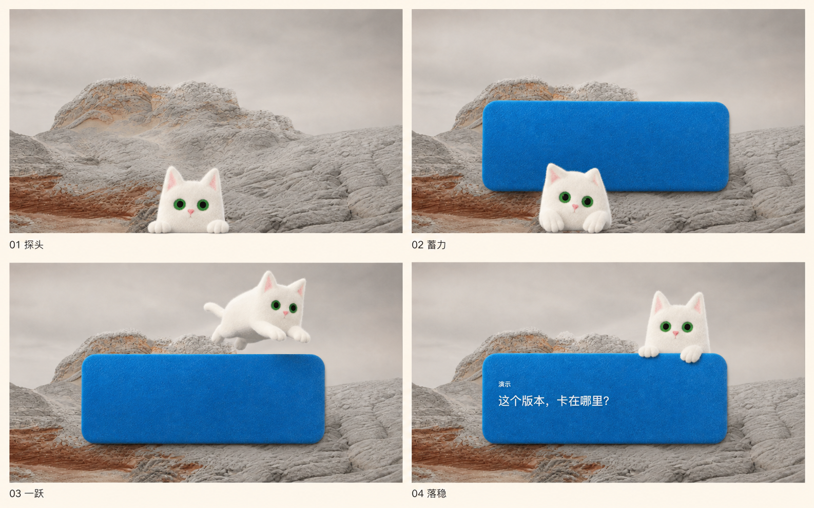

# First encounter: one cat, one landing

## Approved direction

The user approved the four-keyframe storyboard on 2026-09-07 after rejecting a busier eight-frame treatment. The illustrations below are **acting and composition references**, not production animation, a replacement character root, or a baked desktop background. The September 10 presentation revision in [onboarding.md](onboarding.md) replaces the broad blue frame with a warm neutral reading surface with an unframed edge under the paws; it preserves the approved character and acting.

The actual user's desktop remains visible beneath a translucent charcoal dimmer during the full-screen encounter and introduction. As requested on 2026-09-10, it fades in over 720 ms and fades out over 600 ms during the existing window handoff; the character and reading surface stay above it at their original brightness. Reduced motion settles the dimmer immediately. The dimmer covers the native stage independently of the contracting content, and the handoff paint receipt waits for both animations before native placement. Windowed setup, the companion and the separate Settings window have no dimmer. Mochi peeks from the physical lower screen edge, notices the destination, compresses, makes one real full-body hop, and lands with both complete paws over the reading surface’s edge. Only after settling does the surface show the labelled conversation defined in [onboarding.md](onboarding.md). The same compact surface and character remain as the conversation continues. The landing, final character placement and narrow-width layout consume one shared horizontal offset.

Keep the ivory needle-felt identity, fine loose wool and original green eyes. Native system typography and warm neutral reading surfaces support the character without repeating its texture across the interface. The existing canonical root describes a resting pose; it does not imply missing arms, hind legs or torso. Legs are revealed during the jump, then naturally occluded by the landing. Do not fabricate a new round-headed plush cat, rigid capsule torso, or robotic joints.

No upfront invitation card, opaque backdrop, desktop screenshot, imitation browser chrome, paper slips, nested welcome window, competing badges, or simultaneous text reveals. A white sticker substrate is permitted but cannot hide a bad silhouette. Desktop movement positions the performance; it must never manufacture the acting through a translated still, a morph, or a procedural body warp.

## Implementation boundary

- Native window geometry owns the real desktop stage and eventual window handoff. Renderer geometry is local to that transparent surface. The transparent setup stage hides its detached native buttons, so window controls never float outside its paper; the paper owns its visible close control and drag region while AppKit retains Close Window, minimize and resize capabilities. Closing only dismisses that exact presentation window, and the native menu can reopen it. Companion and Settings retain native window chrome.
- Encounter and introduction share that same full-desktop stage. Landing reveals the story directly, without pausing the character or running a native resize/style handoff. The zero-height arrival anchor places the paws on the exact same baseline as the settled scene. A WebGL backing-store resize immediately redraws the held pose, including while playback is paused, so ResizeObserver cannot publish a cleared canvas between animation frames.
- `motion/manifest.json` schema 3 owns the character event, padded canvas and exact start/end placements. The root PNG is copied at 1:1 scale; no per-candidate resizing or crop repair is allowed.
- The video model owns anticipation, anatomy, gaze, propulsion and landing. The existing frame clock owns playback, pause, reduced motion, terminal hold and preview. A one-shot is not a loop or a reversible stable state.
- Presentation owns the felt surface, occlusion, spatial trajectory and delayed typography. It must follow video-frame progress, not a competing character timer.
- Large event stages use lossless eight-frame atlas pages within the unchanged retained-bitmap budget. The renderer prefetches the next page, pins the displayed source exposure, and pauses the same frame clock if decoding is not ready. Physical events retain the declared source cadence without an adjacent-pose dissolve; the fractional clock continues to place the actor smoothly. Ordinary approved loops and states retain their single-atlas layout and pixels.
- First/last generation keyframes are deterministic placements of the same verified input: runtime root or existing hash-pinned high-resolution reference. Inputs may retain their original alpha or be composited on the manifest blue plate. The reference keeps its native pixels with proportionally padded coordinates; it never becomes a new runtime root. Both inputs contain the prepared padded pixels. During compilation, transparent endpoints are losslessly reconstructed from the runtime root. Seam RMSE is normalized to the original root-canvas area, so extra transparent space cannot weaken the existing gate. Coverage extraction and its visible-perimeter definition are shared and tested, as documented in `motion/README.md`. Protection follows eroded observed foreground, never a stationary face rectangle.
- The optional hash-pinned motion-reference input reuses a reviewed video's acting, not its rejected matte. In this mutually exclusive provider mode, the same two prepared images are composition references rather than strict keyframes. Exact compiled endpoints and their seam gates remain mandatory. No presentation or runtime semantics change.

## Integration evidence — 2026-09-08

The user confirmed the wool/fiber quality of `motion/references/encounter-body.png`. It now guides **material and anatomy**, not pose alone. Three additional real Seedance sources were generated using the supplied CLI; A supplies the selected `encounter` sequence. The manifest retains the actual task/source/asset hashes and concrete rejection reasons for other sources.

- Real acting: anticipatory look/crouch, compact full-body pounce, four coherent limbs, then the resting pose. The complete video remains forward-only and never loops or reverses.
- Compilation: native-resolution per-frame four-corner plate calibration, coverage/foreground estimation, then resampling. A single fixed color sampled at two seconds caused a faint later-frame halo because the generated blue plate changes from roughly #0071C5 to #0064B5 and back. The shared sampler follows this actual plate; it rejects nonuniform corners or nonsaturated blue instead of accepting foreground as background.
- The known-alpha regression preserves significantly more fine fibers than the retired similarity-radius key; a separate ground-truth fixture exposes the old opaque-core perimeter's inability to count translucent fibers. The metric definition change, unchanged numeric floors, preserved daily assets and exact diagnostic results are explicit in [motion/README.md](../motion/README.md). No individual frames are painted, morphed or repaired.
- Selected binary SHA-256: `6620d60bb6f104089cc4a26ac6c0902d7f57f126127df3e0d87916dd35441d93`. Root seam 0.04184625 and ending seam 0.04314360 remain within the original normalized limits. Soft ratio is 0.08154924 and visible perimeter 7.08047856. The seven approved daily animations and root hashes are unchanged.
- `character.entrance` binds the sequence and ordered frame cues. The one actual fractional video clock drives the actor, a shallow ballistic spatial arc, panel reveal and contact. The arc has a genuine apex before contact, rather than translating the cat monotonically up through the panel. The panel appears during approach, with no upfront invitation card.
- Replay covers the whole arrival or peek/jump/landing cues, every connection step, failure and completed setup even with an offline backend. Preview facts are explicitly labelled examples and cannot call providers or alter setup. Skip cancels to the exact root before handoff; reduced motion enters the settled scene directly.
- WebKit exercises the actual React/canvas/Three rendering path: transparent document pixels, full generated entrance, one persistent canvas and felt frame, delayed story, Escape, reduced motion, paged atlases and unchanged endpoint RGBA. Actual production pixels are compared across **every atlas page**, not a single-page assumption.
- The exact owned development bundle was built and launched; native host, React and motion readiness were proved. An unlocked **whole-screen recording** confirmed actual desktop/windows through the transparent area and the generated full-body hop onto the felt frame. Window-only JPEG captures flatten alpha and cannot establish that fact; no screenshot is used as a product background.
- Native review exposed two defects: the Dock occluded the peek, and the 0.43-root baseline offset exposed mostly ear tips before takeoff. The offset is now 0.22, with a WebKit pixel regression requiring visible green eyes **before** flight or panel reveal. AppKit temporarily uses active-app `autoHideDock + autoHideMenuBar` during the desktop presentation; planning a windowed destination or closing the window restores prior options. It never changes Dock preferences, disables app switching or hides system controls permanently. See [Apple's presentation contract](https://developer.apple.com/documentation/appkit/nsapplication/presentationoptions-swift.struct).
- Replaying also exposed duplicate React sibling keys retaining orphaned skip controls. The stateless encounter no longer has a replay key; story/setup reset keys are distinct. Repeated replay tests require one encounter, one character canvas, and no retained skip control after arrival.
- Unlocked native recording now confirms the eye reveal at the physical desktop bottom, full-body flight and landing, active-app Dock/menu hiding, restoration on app switching, and the continuous scene-to-setup handoff. Native frame review exposed a separate ghosting defect in the unpublished 10 fps output: adjacent-frame dissolves duplicated fast-moving anatomy. The same pinned source was recompiled and reviewed separately at its native 24 fps (96 lossless exposures); no acting or matte threshold changed. The manifest cues were converted to that cadence. The final recording shows the corrected performance from eye reveal through flight, landing and story; a separate native recording confirms the continuous setup handoff. The felt surface is now the sole shadow owner: disabling the duplicate AppKit window shadow removes the offset black contour without altering the paper outline or generated fibers.
- Native window close was followed by a read-only WindowServer inventory confirming that this exact preview process had no on-screen window; Cmd-0 reopened the same setup preview. Native menu replay also exposed missing initial WebView keyboard focus. The encounter now focuses its accessible heading, and a fresh native replay confirms that the first Escape reaches setup with one character and no leftover skip control. WebKit separately tests the same focus and replay contract.

This is an **integration candidate**, not a claim of finished product delivery. The scoped native desktop review above is complete. Before merging/deploying the broader ToC branch, complete the real provider/runtime/release acceptance listed in [onboarding.md](onboarding.md). The running Bridge, worker, credentials, configuration and permanent Session remain untouched. Exact-commit automated evidence belongs in the PR verification record.

## September 10 shared desktop finish

The companion, introduction and setup consume the same semantic color/type/control tokens as Settings. Mochi keeps a light, warm-paper appearance even when macOS uses Dark Mode so type and controls remain legible; the desktop still shows through the native material. The daily window uses a small local felt landing pad over a fully composed, system-owned native material; it does not paint a texture across the desktop aperture. As refined on September 16, the full-screen dimmer uses pure black at 38% opacity, with neutral text, hairlines and shadows across the shared theme. It must not tint the desktop blue-black. The host's paint-gated window handoff and dimmer timing are unchanged. Character rendering follows actual display density and uses premultiplied mip filtering; root/atlas/entrance source files and their geometry are unchanged. See [onboarding.md](onboarding.md) for the compact panel contract and the distinction between renderer-alpha evidence and the native backdrop acceptance gate.

On September 11, the exact Development App was reviewed on an unlocked desktop. Whole-screen recordings separately cover entry, full-screen exit and introduction → setup; the wallpaper remains visible through the appropriate transparent areas. Native Settings opens independently and closing it restores the daily panel. Exiting previews restores real duty with the existing connected deployment. This closes the previous lock-screen evidence gap for the current Mac; no source animation, permanent Session or provider authorization was changed.
